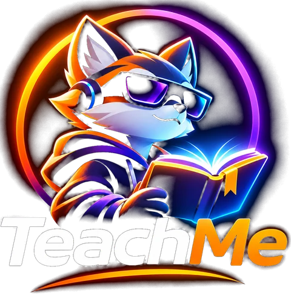

<p align="center">
  
</p>

<h1 align="center">Teach Me courses</h1>

<p align="center">
  A shared library of courses for <a href="https://teach-me.software/">Teach Me</a><br>
  by <a href="https://hasbrains.com/">Has Brains AI</a>
</p>

---

Teach Me helps you learn with guided lessons, practice, quizzes, and an AI tutor that adapts to your gaps. This repository is the **public course hub**: a place to find courses other people made and share one of your own.

## Why this hub exists

A useful course should be easy to reuse, inspect, and improve. Keeping the catalog here means every course has a visible history, contributors can suggest fixes by pull request, and the Teach Me app can browse courses from a simple public `index.json`. Your learning history remains yours; it is not part of a shared course.

## Find a course

Open **Course hub → Browse** in Teach Me. Pick a course, read its details, and install it into your library. You can also inspect the folders in [`courses/`](courses/) before installing. The catalog grows as course pull requests are reviewed and merged.

### Now in the hub

**[Robotics: Build a Voice-Controlled Robotic Hand](courses/andrewnovykov-robotics-build-a-voice-controlled-robotic-hand/)** by @andrewnovykov · Beginner · 8 lessons · about 8 hours. Start with an LED and an ESP32, then build toward a hand controlled by spoken commands.

Your first course works without a key. To unlock additional courses, [get a free Teach Me key](https://keys.endorphinlab.dev/apps/teach-me) and enter it in **Settings → License**.

## Share a course

1. Finish and review the course in Teach Me. Resolve its course Problems and check that its lessons, quizzes, links, and examples work for another learner.
2. Open **Course hub → Share a course** and choose the course from your library.
3. Review the safety report and the exact file list. The app excludes local settings and other private files.
4. Sign in to GitHub if prompted, then choose **Open a pull request on GitHub**.
5. Check the pull request and respond to review feedback. After it is merged, the course appears in the hub catalog.

The app creates a fork and a branch for you. You can also contribute manually: fork this repository, add a folder named `courses/<your-github-login>-<course-slug>/`, and open a pull request to `main`.

### Course folder

```text
courses/<your-github-login>-<course-slug>/
├── course.yaml       # Public listing: name, author, level, tags, hours
├── course.json       # Course manifest
├── plan/             # Roadmap and concepts
├── lessons/          # Lessons and quizzes
├── shared/           # Optional reusable course material
└── knowledge/        # Optional course knowledge
```

Keep the course self-contained and use links that readers can open. `course.yaml` is generated by Teach Me when you share from the app. Each course declares its own license there; the app currently shares courses under MIT.

### What stays on your computer

The app does not share learner progress, local settings in `.teachme/`, exports, `.env` files, keys, logs, symlinks, or files over 1 MB. Review the proposed files before opening a pull request; never put credentials or personal data into lesson material. The app runs a safety check before sharing, and maintainers review contributions before merging.

## How the catalog works

[`index.json`](index.json) is the format 1 catalog read by Teach Me. When course folders change on `main`, [GitHub Actions](.github/workflows/index.yml) rebuilds the index from their metadata. Course content lives in this repository; the app installs a copy into your library. If you spot a broken lesson or a missing prerequisite, open an issue or suggest a fix in a pull request.

## Links

- [Teach Me website](https://teach-me.software/)
- [Teach Me](https://github.com/endorphin-ai/TEACH-ME)
- [Get a free key](https://keys.endorphinlab.dev/apps/teach-me)
- [Has Brains AI](https://hasbrains.com/)
- [Suggest an improvement](https://github.com/endorphin-ai/teach-me-courses/issues/new)
