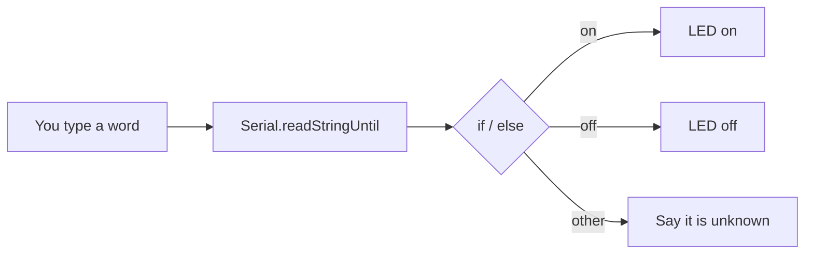

# Tutorial 2: Your First Code: Variables, Decisions, Functions and Serial

> **Time**: 60 min | **Difficulty**: Beginner
> **Prerequisites**: [Tutorial 1](../01-meet-the-circuit/lesson.md)

## What You'll Learn

- How a variable remembers a value.
- How `if` and `else` let the board decide.
- How a function names a reusable piece of code.
- How Serial lets you type to the board and read its answers.

## Why This Matters

:::hook {kind="surprise"}
Your blink sketch never listens. In a few lessons the hand must hear "close" and choose the right action. Before voices, we do the same with typing: you type `on` and the LED lights; you type `off` and it goes dark. If you can do that, you have built the skeleton of the whole project.
:::

**Key idea: a program is values that are remembered (variables), choices that are made (if), pieces that are named (functions) and a way to talk to the world (Serial).**

The supporting points:
1. Variables hold numbers, such as a servo angle or a sound level.
2. `if` turns a comparison into an action: the heart of "if the word is close, then close".
3. Functions give actions names: `closeHand()` will become one line.
4. Serial is your window into the board and, for now, your keyboard-shaped microphone.

## Walkthrough

### Step 1: Variables

:::note {kind="key"}
Variable: a named place in memory that holds a value of a stated type, such as int (whole number), float (decimal), bool (true/false) or String (text).
:::

:::analogy {concept="c04"}
title: A labelled box
boundary: A box holds anything; a variable holds only the type it was declared with, and an int cannot hold 2.5.
---
You write "angle" on a box and put 90 in it. Later you can look in the box, or swap the contents for 120. The label stays the same.
:::

:::example {concept="c04" level="minimal"}
title: Three boxes
---
```cpp
// variables.ino
int angle = 90;          // whole number
float volts = 3.3;       // decimal number
bool handIsOpen = true;  // yes or no

void setup() {
  Serial.begin(115200);
  angle = angle + 30;    // angle is now 120
  Serial.println(angle);
}

void loop() { }
```
`angle = angle + 30` is not algebra: it reads "work out the right side, then store it in the box".
:::

:::checkpoint {concept="c04"}
question: After `int count = 2; count = count * 3;` what is in count, and why is it not an equation that cannot be true?
expected: 6. The = sign means store: the right side is worked out first and then placed in the box.
---
:::

### Step 2: Decisions with if / else

:::note {kind="key"}
Condition: a question with a true or false answer, such as level > 500, that an if statement uses to pick which code runs.
:::

:::analogy {concept="c05"}
title: A fork in the road with a sign
boundary: A traveller can reconsider; the board checks the sign each pass through loop(), and only that moment counts.
---
The sign says "if raining, take the covered path, else take the open path". The board reads the sign and walks one path.
:::

Comparison symbols: `==` equal, `!=` not equal, `<` less, `>` greater, `<=`, `>=`.

:::example {concept="c05" level="realistic"}
title: Loud or quiet
---
```cpp
// decide.ino
int level = 620;

void setup() {
  Serial.begin(115200);
  if (level > 500) {
    Serial.println("loud");
  } else {
    Serial.println("quiet");
  }
}

void loop() { }
```
:::

:::checkpoint {concept="c05"}
question: If level is 500, which message prints for `if (level > 500) {...} else {...}`, and why?
expected: The else branch, because 500 is not greater than 500.
---
:::

### Step 3: Functions

:::note {kind="key"}
Function: a named block of code you can run by writing its name followed by parentheses.
:::

:::analogy {concept="c06"}
title: A recipe card
boundary: A card is only text; a function can take inputs and hand a result back.
---
Instead of rewriting "how to make tea" every time, you write "make tea" once on a card and say its name. Fix the card once and every use is fixed.
:::

You already met two functions: `setup()` and `loop()`. The board calls them for you. You can write your own.

:::example {concept="c06" level="minimal"}
title: A named action
---
```cpp
// functions.ino
const int LED_PIN = 4;

void ledOn()  { digitalWrite(LED_PIN, HIGH); }
void ledOff() { digitalWrite(LED_PIN, LOW); }

void blink(int times) {          // a function that takes an input
  for (int i = 0; i < times; i++) {
    ledOn();  delay(150);
    ledOff(); delay(150);
  }
}

void setup() {
  pinMode(LED_PIN, OUTPUT);
  blink(3);                      // three blinks
}

void loop() { }
```
In lesson 4 `ledOn()` becomes `closeHand()`.
:::

:::checkpoint {concept="c06"}
question: What do the words inside the parentheses of blink(int times) do?
expected: They are an input: the caller says how many times, and the function uses that number.
---
:::

### Step 4: Serial, the board's voice and ears

:::note {kind="key"}
Serial: a text link over the USB cable; Serial.print sends text from the board to your Mac, and Serial.read takes characters sent from the Mac to the board.
:::

:::analogy {concept="c07"}
title: Passing notes through the wall
boundary: Notes are slow and visible; serial moves 115,200 bits per second, and both sides must agree on that speed.
---
You slide a note under the door; the board slides one back. Both of you must write in the same language and speed (the baud rate).
:::

Open Tools > Serial Monitor, set the bottom-right drop-down to **115200 baud**, and set the line ending to **Newline**.

:::example {concept="c07" level="realistic"}
title: Type "on" or "off"
---
```cpp
// serial_led.ino
const int LED_PIN = 4;

void setup() {
  pinMode(LED_PIN, OUTPUT);
  Serial.begin(115200);
  Serial.println("Type on or off");
}

void loop() {
  if (Serial.available() > 0) {                 // has a note arrived?
    String word = Serial.readStringUntil('\n'); // read up to the Enter key
    word.trim();                                 // drop spaces and \r
    if (word == "on") {
      digitalWrite(LED_PIN, HIGH);
      Serial.println("LED on");
    } else if (word == "off") {
      digitalWrite(LED_PIN, LOW);
      Serial.println("LED off");
    } else {
      Serial.println("I don't know that word");
    }
  }
}
```
This is the skeleton of the whole project: *hear a word, decide, act*.

**Try it now:** add a third word, `blink`, that calls a blink function, upload, and type it in the Serial Monitor.
:::

:::checkpoint {concept="c07"}
question: Why does the sketch call word.trim() before comparing with "on"?
expected: Typed lines can end with hidden characters such as \r; trim removes them so "on" really equals "on".
---
:::

:::diagram
title: Hear, decide, act
---

:::

## Common Mistakes

:::mistake {concept="c05" title="Using = instead of =="}
::wrong
```cpp
// decide.ino
if (level = 500) { Serial.println("half"); }
```
::right
```cpp
// decide.ino
if (level == 500) { Serial.println("half"); }
```
::why
A single = stores 500 into level and the condition is then always true; == compares.
:::

:::mistake {concept="c07" title="Mismatched baud rate"}
::wrong
Serial.begin(115200) in the sketch, but the Serial Monitor is set to 9600. Output looks like `?x??`.
::right
Set the monitor drop-down to the same 115200.
::why
Each side times the bits by its own clock; if they differ, the characters are read wrongly.
:::

:::mistake {concept="c06" title="Defining a function but never calling it"}
::wrong
```cpp
// functions.ino
void setup() { }
void loop() { }
void blink3() { /* ... */ }
```
::right
```cpp
// functions.ino
void setup() { blink3(); }
```
::why
A function only runs when something calls it by name. setup() and loop() are the exceptions because the board calls them.
:::

:::mistake {concept="c04" title="Using int for a decimal"}
::wrong
```cpp
// variables.ino
int volts = 3.3;   // keeps only 3
```
::right
```cpp
// variables.ino
float volts = 3.3;
```
::why
An int stores whole numbers, so the .3 is thrown away.
:::

## Try It Yourself

:::challenge
title: Blink count
---
::task
Type a number from 1 to 5 and the LED blinks that many times. For any other input, reply "pick 1 to 5". Use blink(int times) from Step 3.
::hint
word.toInt() turns the text "3" into the number 3 (and gives 0 if it is not a number).
::solution
```cpp
// blink_count.ino
const int LED_PIN = 4;

void blink(int times) {
  for (int i = 0; i < times; i++) {
    digitalWrite(LED_PIN, HIGH); delay(150);
    digitalWrite(LED_PIN, LOW);  delay(150);
  }
}

void setup() {
  pinMode(LED_PIN, OUTPUT);
  Serial.begin(115200);
}

void loop() {
  if (Serial.available() > 0) {
    String word = Serial.readStringUntil('\n');
    word.trim();
    int n = word.toInt();
    if (n >= 1 && n <= 5) {
      blink(n);
    } else {
      Serial.println("pick 1 to 5");
    }
  }
}
```
:::

1. Extend serial_led.ino with a third word, `blink`, that calls blink(3).
2. Add a variable `int uses = 0;` that goes up by one on each recognised word and prints it.
3. Make the monitor baud wrong on purpose and note what you see.

:::quiz {ref="q3"}
:::

:::quiz {ref="q6"}
:::

## Key Takeaways

:::takeaways
- A variable is a typed, labelled box; = stores, == compares.
- if / else turns a comparison into an action.
- A function names a reusable action, so later code reads like a sentence.
- Serial lets you type words to the board and read replies; both sides must use the same baud rate.
:::

We come back to Serial in [lesson 5: Typed Commands](../05-typed-commands/lesson.md), where whole words pick which finger moves, and to functions in [lesson 4: The Hand](../04-the-hand/lesson.md), where each gesture is one.

## What's Next

You can now decide and talk. In [lesson 3: Servo Motion](../03-servo-motion/lesson.md) you give the board something to move: a servo.

:::bridge {to="03-servo-motion"}
You can make a pin high or low. A servo needs something finer: a pulse whose width sets an angle.
:::

:::homework {kind="practice"}
Add the words `fast` and `slow` that change a variable `int pause` used inside blink(), so typing `fast` makes the blinking quicker. Keep this sketch: lesson 5 turns the same skeleton into hand commands.
:::

## Further Reading

:::docs
title: Arduino Serial reference
url: https://www.arduino.cc/reference/en/language/functions/communication/serial/
---
Every Serial function (available, read, readStringUntil, println); this lesson shows the three you need first.
:::
