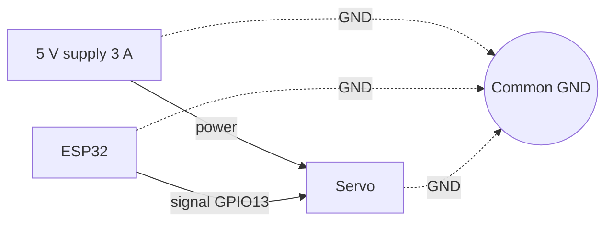

# Tutorial 3: Servo Motion: Pulses, Power and Angles

> **Time**: 60 min | **Difficulty**: Beginner
> **Prerequisites**: [Tutorial 1](../01-meet-the-circuit/lesson.md), [Tutorial 2](../02-first-code/lesson.md)

## What You'll Learn

- How a pulse width tells a servo which angle to hold.
- Why servos need their own 5 V supply and a shared ground.
- How to move a servo with the ESP32Servo library.

## Why This Matters

:::hook {kind="problem"}
Five servos wired straight to the USB port look fine for a second. Then all five twitch at once, the board reboots, and the Serial Monitor prints garbage. Nothing is broken; the power was simply not enough. Today you learn the wiring rule that prevents it, before a single finger moves.
:::

**Key idea: a servo holds an angle set by the width of a repeating pulse on its signal wire, and it needs its own 5 V power with a ground shared with the ESP32.**

Three points support it:
1. The signal is a pulse width (PWM), not a voltage level.
2. Power is a separate, much bigger flow than the signal, and the two circuits meet only at ground.
3. A library turns "go to 90 degrees" into the right pulses for you.

## Walkthrough

### Step 1: The signal is a pulse

:::note {kind="key"}
PWM (pulse width modulation): switching a pin on and off in a repeating pattern, where the length of the "on" part carries the information. A hobby servo repeats a pulse about 50 times a second and reads its width.
:::

:::analogy {concept="c08"}
title: Tapping a table with a long or short knock
boundary: The servo does not count knocks; it measures each knock's length, and the time between knocks must stay near 20 ms.
---
A very short tap (about 0.5 ms) tells the servo "go all the way to one end". A long tap (about 2.4 ms) means "go to the other end". A middle tap (about 1.45 ms) means the middle. The servo keeps pushing until its arm matches.
:::

Your 3 wires: **brown or black** = ground, **red** = 5 V power, **orange or yellow** = signal.

:::example {concept="c08" level="minimal"}
title: Three pulses, three angles
---
```text
# pulse-table.txt
pulse  500 us  ->   0 degrees   (one end)
pulse 1450 us  ->  90 degrees   (the middle)
pulse 2400 us  -> 180 degrees   (the other end)
repeat every 20 ms (50 times a second)
```
Between the pulses the signal is LOW. The servo reads only how long each HIGH lasts, so a wider pulse always means a bigger angle.
:::

:::widget {id="pulse" kind="calculator" height="260" title="Pulse width to servo angle" concept="c08" alt="A slider sets the pulse width from 500 to 2400 microseconds and shows the servo angle it commands, with a needle that rotates."}
```css
.row { display: grid; gap: 10px; }
label { display: flex; justify-content: space-between; color: var(--dim); }
input[type=range] { width: 100%; accent-color: var(--accent); }
.big { font-size: 26px; font-weight: 800; color: var(--accent); }
.dial { position: relative; width: 140px; height: 70px; border: 2px solid var(--line); border-bottom: none; border-radius: 140px 140px 0 0; margin: 6px auto 0; }
.needle { position: absolute; left: 50%; bottom: 0; width: 3px; height: 62px; background: var(--accent); transform-origin: bottom center; }
```
```html
<div class="row">
  <label for="pw">Pulse width <b id="pwv">1450 us</b></label>
  <input id="pw" type="range" min="500" max="2400" value="1450" step="10">
  <p>Servo angle: <span class="big" id="ang" role="status">90 degrees</span></p>
  <div class="dial" aria-hidden="true"><div class="needle" id="needle"></div></div>
</div>
```
```js
function draw() {
  const pw = document.getElementById('pw').valueAsNumber;
  if (!Number.isFinite(pw)) return;
  const angle = Math.round((pw - 500) / (2400 - 500) * 180);
  document.getElementById('pwv').textContent = pw + ' us';
  document.getElementById('ang').textContent = angle + ' degrees';
  document.getElementById('needle').style.transform = 'rotate(' + (angle - 90) + 'deg)';
}
function setup() {
  document.getElementById('pw').addEventListener('input', draw);
  draw();
}
```
```js-run
setup();
```
:::

:::math {track="mathematical"}
::formula
$$ \text{angle} = \frac{\text{pulse} - 500}{2400 - 500} \times 180 $$
::meaning
Subtract the shortest pulse, divide by the pulse range, and scale to 180 degrees. Real servos differ a little, which is why we calibrate in lesson 4.
:::

:::checkpoint {concept="c08"}
question: Which pulse width would you expect to command about 45 degrees, and does the servo care about the voltage of the pulse?
expected: A pulse of about 975 microseconds (a quarter of the way from 500 to 2400). Only the width matters; the pulse level just has to be high enough to read as ON (3.3 V is enough for most).
---
:::

### Step 2: Power and common ground

:::note {kind="key"}
Common ground: two separate power sources must have their ground wires connected, so a signal has the same zero-volt reference on both sides.
:::

A servo moving or pushing against something can pull 0.5 to 1 A or more. Five at once can pull several amps. USB gives about 0.5 A, and the board's 5V pin is just USB passed through. So the servo power must come from its own **5 V supply rated 3 A or more**.

:::analogy {concept="c09"}
title: Two people measuring height from the same floor
boundary: Floors are physical; a ground wire is a shared zero for voltage, and it also carries the return current.
---
If one person stands on a stool and the other on the ground, "I am 1.7 m tall" means different things. The signal is a height reading: the ESP32 says "3.3 V" and the servo must measure from the same floor to agree. Joining the ground wires puts both on one floor.
:::

```text
# servo-wiring.txt
5 V supply (+) ----------------> servo red wire (all servos)
5 V supply (-) ----+-----------> servo brown wire (all servos)
                   |
                   +-----------> ESP32 GND pin        <-- the shared ground
ESP32 GPIO13 -----------------> servo orange wire (signal)
470-1000 uF capacitor across supply (+) and (-), long leg to (+)
```

The capacitor is a tiny rechargeable tank. When a servo starts it grabs a burst of current, and the capacitor supplies it so the 5 V does not dip and reset the board. It has a polarity: the long leg (or the side without the stripe) goes to +. Backwards, it can pop.

:::example {concept="c09" level="realistic"}
title: Breadboard layout for one servo
---
Use the breadboard's side rails: top red rail = supply +5 V, top blue rail = supply ground. Run a jumper from the ESP32 GND to the blue rail. Put the capacitor straight across the two rails, long leg to red. Plug the servo's three wires into three holes in one row: red to the red rail, brown to the blue rail, orange to a jumper going to GPIO13.
:::

:::note {kind="warning"}
Check polarity before switching on: red = +, black/brown = -. A reversed supply can destroy the servo. Never connect the 5 V rail to any ESP32 pin other than via the board's intended 5V/VIN input, and never connect 5 V to a GPIO.
:::

:::checkpoint {concept="c09"}
question: The servo has its own 5 V supply and the signal is connected, but it does not respond. What single connection do you check first?
expected: That the supply ground is connected to the ESP32 GND pin.
---
:::

:::diagram
title: Two circuits, one shared ground
---

:::

### Step 3: Move it with code

:::note {kind="key"}
ESP32Servo: an Arduino library that creates the 50 Hz pulses on a pin; attach() chooses the pin and pulse range, and write(angle) sets the angle in degrees.
:::

:::analogy {concept="c10"}
title: A translator who speaks pulse
boundary: The translator does not know your servo's real limits; you still choose a safe range.
---
You say "90 degrees". The library works out the pulse width and repeats it 50 times a second so you do not have to.
:::

**Pins and delivery reminder:** some pins (GPIO 0, 2, 5, 12 and 15) have special jobs while the board starts, so for servos we use 13, 14, 25, 26 and 27 only. Also check your hand's delivery date now; if it is late, lesson 4 works with one servo and a paper-strip finger.

**The 10 to 170 rule:** a servo's 0 and 180 are its mechanical end stops. If code asks for them, or for a number beyond them, the motor keeps pushing against the stop, hums, draws extra current and wears its gears. So we always keep angles between 10 and 170 ourselves, whatever the library does with out-of-range numbers.

**Try it now:** after the sweep example below, change ANGLE_MIN and ANGLE_MAX to 60 and 120 and watch the range shrink.

Install it: Sketch > Include Library > Manage Libraries, search `ESP32Servo`, install.

:::example {concept="c10" level="minimal"}
title: Go to the middle
---
```cpp
// one_servo.ino
#include <ESP32Servo.h>

Servo finger;
const int SERVO_PIN = 13;

void setup() {
  finger.attach(SERVO_PIN, 500, 2400);  // pin, min and max pulse in microseconds
  finger.write(90);                      // hold the middle
}

void loop() { }
```
:::

:::example {concept="c10" level="realistic"}
title: A safe sweep
---
```cpp
// sweep.ino
#include <ESP32Servo.h>

Servo finger;
const int SERVO_PIN = 13;
const int ANGLE_MIN = 10;    // stay away from the end stops
const int ANGLE_MAX = 170;

void setup() {
  finger.attach(SERVO_PIN, 500, 2400);
}

void loop() {
  for (int a = ANGLE_MIN; a <= ANGLE_MAX; a++) {
    finger.write(a);
    delay(15);                // 15 ms per degree = slow and gentle
  }
  for (int a = ANGLE_MAX; a >= ANGLE_MIN; a--) {
    finger.write(a);
    delay(15);
  }
}
```
:::

:::checkpoint {concept="c10"}
question: Why does the sweep use ANGLE_MIN of 10 and ANGLE_MAX of 170 rather than 0 and 180?
expected: To keep the motor from pushing against its end stops, which makes it hum, draw extra current and wear out.
---
:::

## Common Mistakes

:::mistake {concept="c08" title="Thinking the voltage sets the angle"}
::wrong
Trying to hold a servo at 90 degrees with digitalWrite(13, HIGH) because "half way needs half the voltage".
::right
Use the library: finger.write(90) sends a repeating 1.45 ms pulse.
::why
A steady HIGH is not a pulse at all. The servo reads the width of each pulse, repeated about 50 times a second, so a fixed voltage tells it nothing.
:::

:::mistake {concept="c09" title="Powering servos from the board"}
::wrong
Servo red wire into the ESP32 5V pin and the board powered only by laptop USB, with five servos moving at once.
::right
Servo red wires on the separate 5 V supply, the supply ground joined to the ESP32 GND.
::why
The USB port cannot supply the burst current, so the voltage collapses and the ESP32 resets (a "brown-out").
:::

:::mistake {concept="c09" title="Reversing the power leads"}
::wrong
Red servo wire on the supply ground rail and brown on +5 V.
::right
Red to +5 V, brown or black to ground. Check each wire with a finger on the plug colour before switching on.
::why
Reverse polarity can burn the servo's control chip in a moment.
:::

:::mistake {concept="c10" title="Commanding the end of the range"}
::wrong
```cpp
// sweep.ino
finger.write(0);
finger.write(180);
```
::right
```cpp
// sweep.ino
finger.write(10);
finger.write(170);
```
::why
Servo ranges vary; asking for the extreme end can push against the stop and strain the gears.
:::

:::mistake {concept="c10" title="Using a strapping pin for the signal"}
::wrong
```cpp
// one_servo.ino
const int SERVO_PIN = 12;
```
::right
```cpp
// one_servo.ino
const int SERVO_PIN = 13;
```
::why
GPIO12 is read at boot to set the flash voltage; a connected servo can stop the board from starting. We use 13, 14, 25, 26 and 27 for the fingers.
:::

## Try It Yourself

:::challenge
title: Servo by typing
---
::task
Combine lesson 2 and this lesson: type a number from 10 to 170 in the Serial Monitor and the servo moves to that angle. Ignore numbers outside the range and print a message.
::hint
Use word.toInt() and an if with && to test both limits, then finger.write(n).
::solution
```cpp
// servo_by_typing.ino
#include <ESP32Servo.h>

Servo finger;
const int SERVO_PIN = 13;

void setup() {
  Serial.begin(115200);
  finger.attach(SERVO_PIN, 500, 2400);
  Serial.println("Type an angle 10 to 170");
}

void loop() {
  if (Serial.available() > 0) {
    String word = Serial.readStringUntil('\n');
    word.trim();
    int n = word.toInt();
    if (n >= 10 && n <= 170) {
      finger.write(n);
      Serial.println("moved");
    } else {
      Serial.println("out of range");
    }
  }
}
```
:::

1. Move the widget slider and predict the angle before you read it.
2. Build the one-servo circuit and run sweep.ino.
3. Change the delay to 5 and then 40 and note the speed difference.

:::quiz {ref="q3"}
:::

:::quiz {ref="q4"}
:::

## Key Takeaways

:::takeaways
- A servo's angle comes from the width of a pulse repeated about 50 times a second.
- Servos get their own 5 V supply (3 A or more for five); the grounds are joined with the ESP32's.
- A capacitor across the supply smooths the bursts when servos start.
- attach(pin, 500, 2400) and write(angle) do the work; keep angles away from the end stops.
:::

We come back to common ground in [lesson 4: The Hand](../04-the-hand/lesson.md), with five servos, and again in [lesson 6: The Microphone](../06-microphone/lesson.md), where the mic shares the same ground.

## What's Next

One servo sweeps. In [lesson 4: The Hand](../04-the-hand/lesson.md) you assemble the hand, tie five servos to five fingers, and name the poses.

:::bridge {to="04-the-hand"}
You can move one servo to any angle. Next you move five, each to the right angle for open, close and point.
:::

:::homework {kind="practice"}
Draw by hand the wiring diagram for five servos: five signals to GPIO 13, 14, 25, 26 and 27, one 5 V supply, one shared ground. Label every wire colour. Lesson 4 uses this drawing when the hand arrives.
:::

## Further Reading

:::docs
title: ESP32Servo library
url: https://github.com/madhephaestus/ESP32Servo
---
The README lists supported boards and the attach and write calls; this lesson adds the power wiring that the README assumes you know.
:::

:::docs
title: Arduino-ESP32 LEDC (PWM) API
url: https://docs.espressif.com/projects/arduino-esp32/en/latest/api/ledc.html
---
The lower-level PWM hardware that the servo library uses underneath; useful if you want to see how the pulses are produced.
:::
