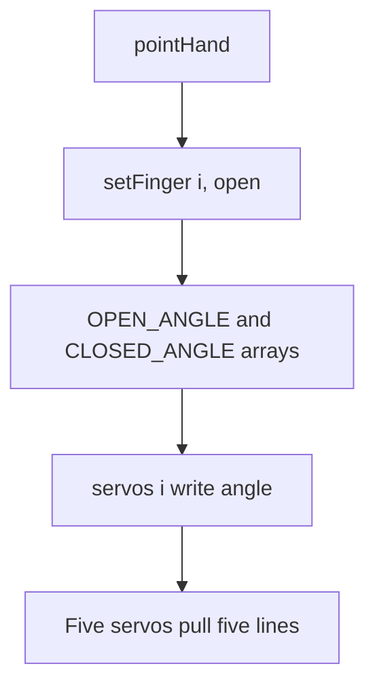

# Tutorial 4: The Hand: Fingers, Calibration and Gestures

> **Time**: 60 min | **Difficulty**: Beginner
> **Prerequisites**: [Tutorial 2](../02-first-code/lesson.md), [Tutorial 3](../03-servo-motion/lesson.md)

## What You'll Learn

- How a servo bends a finger through a tendon.
- How to store each finger's open and closed angle in arrays.
- How to wrap poses in functions: open, close, point.

## Why This Matters

:::hook {kind="story"}
Hands are the hardest thing in a robot. Your own hand has 27 bones and dozens of muscles. The printed hand cheats beautifully: five small motors and five lengths of line. Today the parts come out of the box, and by the end the hand makes a fist on command.
:::

**Key idea: a finger is a servo pulling a line, so each pose is five numbers, and naming each set of numbers as a function turns a pile of servos into a hand that obeys words.**

Three points support it:
1. The mechanics decide which angle means "open" and "closed".
2. Arrays store those numbers per finger, found once by calibration.
3. Gesture functions give every pose a name that voice commands will call later.

## Walkthrough

### Step 1: How the finger moves

:::note {kind="key"}
Tendon-driven finger: a hinged finger with a line (tendon) running from the fingertip to a servo arm; turning the servo pulls the line and curls the finger, while elastic or a second line straightens it.
:::

:::analogy {concept="c11"}
title: A puppet on a string
boundary: A puppet falls limp when you let go; here an elastic band or a second line brings the finger back, so release is a spring, not gravity.
---
Pull the string and the limb bends. Let it go and the spring straightens it. The servo is the hand pulling the string.
:::

Every printed hand differs, so follow the seller's assembly guide. These steps hold for most:
1. Set each servo to 90 degrees **before** fitting the horn, using the one_servo.ino sketch from lesson 3 (it holds `finger.write(90)`; change SERVO_PIN for each servo), so every horn starts at the same place.
2. Attach the horn, run the line from fingertip through the guides to the horn hole, tie it, and keep the finger straight.
3. Mount all five servos on the forearm, labelled thumb, index, middle, ring, pinky.
4. Wire signals to GPIO 13 (thumb), 14 (index), 25 (middle), 26 (ring) and 27 (pinky), and all power as in lesson 3.

:::note {kind="warning"}
Keep your fingers out of the hand when the supply is on. A servo that pulls a line against a fingertip can pinch. Switch the supply off while tying lines.
:::

:::example {concept="c11" level="minimal"}
title: Test a single finger by hand
---
```cpp
// test_finger.ino
#include <ESP32Servo.h>

Servo finger;

void setup() {
  finger.attach(13, 500, 2400);
}

void loop() {
  finger.write(60);  delay(1500);   // does the finger straighten?
  finger.write(120); delay(1500);   // does it curl?
}
```
Start with this small 60 to 120 sweep. Widen it (for example 40 to 140) only while the line is not stretched tight and the servo does not hum. Watch for the line going slack at one end and tight at the other. If the finger does not fully straighten, retie the line.
:::

:::note {kind="tip"}
No hand yet? Everything in this lesson can be tested with one servo: tape a stiff paper strip to the horn as a "finger" and use one servo on GPIO13. Calibrate its two angles, write the arrays with five identical entries, and the sketches still run. Check your delivery tracking now so the hand arrives in time.
:::

:::checkpoint {concept="c11"}
question: The servo turns but the finger only curls halfway. What could be loose or too small?
expected: The line is slack, or the horn arm is too short to pull enough line; retension the line or use a longer horn hole.
---
:::

### Step 2: Calibration with arrays

:::note {kind="key"}
Calibration: measuring, per finger, the servo angles that give a fully open and a fully closed finger, then storing them so the rest of the code uses names, not magic numbers.
:::

:::analogy {concept="c12"}
title: Marking a ruler on each door
boundary: Door marks stay fixed; your angles can drift if a line stretches, so you re-check them now and then.
---
Every door in a house swings a little differently. You mark on each one where "closed" and "wide open" are. Later you say "close the door" and each door goes to its own mark.
:::

An **array** is a numbered row of boxes of the same type. Counting starts at zero.

**Try it now:** after calibrating, change CLOSED_ANGLE for one finger by 10 degrees and see how the fist changes.

:::example {concept="c12" level="realistic"}
title: Calibration arrays and a one-finger setter
---
```cpp
// hand.ino
#include <ESP32Servo.h>

const int FINGERS = 5;
const int PINS[FINGERS]       = {13, 14, 25, 26, 27};   // thumb, index, middle, ring, pinky
int OPEN_ANGLE[FINGERS]   = {30, 30, 30, 30, 30};       // calibrate: finger straight
int CLOSED_ANGLE[FINGERS] = {150, 150, 150, 150, 150};  // calibrate: finger curled

Servo servos[FINGERS];

void setFinger(int i, bool open) {
  servos[i].write(open ? OPEN_ANGLE[i] : CLOSED_ANGLE[i]);
}

void setup() {
  for (int i = 0; i < FINGERS; i++) {
    servos[i].attach(PINS[i], 500, 2400);
    setFinger(i, true);   // start open
  }
}

void loop() { }
```
`open ? A : B` means "if open is true use A, otherwise use B".
:::

How to calibrate: for each finger, nudge a test angle until the finger is straight but the line is not stretched, write it in OPEN_ANGLE; then curl it as far as it goes without the servo straining, and write that in CLOSED_ANGLE. A finger mounted in the opposite direction simply has the larger number for open.

:::example {concept="c12" level="challenging"}
title: Tune live from the Serial Monitor
---
```cpp
// calibrate.ino
#include <ESP32Servo.h>

const int PINS[5] = {13, 14, 25, 26, 27};
Servo servos[5];

void setup() {
  Serial.begin(115200);
  for (int i = 0; i < 5; i++) servos[i].attach(PINS[i], 500, 2400);
  Serial.println("Type: finger angle, e.g. 1 120");
}

void loop() {
  if (Serial.available() > 0) {
    int f = Serial.parseInt();      // reads the first whole number typed: the finger
    int a = Serial.parseInt();      // reads the next whole number: the angle
    // peek() looks at the next character without taking it; anything <= ' ' is a
    // space or the Enter key, so this loop throws away the leftover Enter
    while (Serial.available() > 0 && Serial.peek() <= ' ') Serial.read();
    if (f >= 0 && f < 5 && a >= 10 && a <= 170) {
      servos[f].write(a);
      Serial.printf("finger %d -> %d\n", f, a);
    } else {
      Serial.println("finger 0-4, angle 10-170");
    }
  }
}
```
Fingers count from 0: thumb 0, index 1, middle 2, ring 3, pinky 4. Write down the two good angles for each finger.

A sample session in the Serial Monitor (type the two numbers with a space, then Enter):

```text
# calibrate-session.txt
you type: 1 60
board   : finger 1 -> 60
you type: 1 120
board   : finger 1 -> 120
you type: 1 200
board   : finger 0-4, angle 10-170
```
:::

:::checkpoint {concept="c12"}
question: In `int OPEN_ANGLE[5]`, which index is the pinky and why?
expected: Index 4, because arrays start counting at 0 and the pinky is the fifth finger.
---
:::

### Step 3: Gesture functions

:::note {kind="key"}
Gesture function: a named function, such as openHand(), that sets all five fingers to a pose so that any part of the program can ask for that pose by name.
:::

:::analogy {concept="c13"}
title: Sign-language signs
boundary: A sign carries meaning between people; a gesture function only moves motors and has no idea what it means.
---
In sign language, one name stands for a whole arrangement of fingers. `pointHand()` is the same: one name, five finger positions.
:::

:::example {concept="c13" level="minimal"}
title: Open, close and point
---
```cpp
// hand.ino
// Add these below setFinger(), and replace the empty loop().
void openHand() {
  for (int i = 0; i < FINGERS; i++) setFinger(i, true);
}

void closeHand() {
  for (int i = 0; i < FINGERS; i++) setFinger(i, false);
}

void pointHand() {                 // index open, the rest closed
  for (int i = 0; i < FINGERS; i++) setFinger(i, i == 1);
}

void loop() {
  openHand();  delay(1500);
  closeHand(); delay(1500);
  pointHand(); delay(1500);
}
```
`i == 1` is true only for the index finger, so the other four close.
:::

:::checkpoint {concept="c13"}
question: How would you write a peaceSign() with index and middle open?
expected: Loop over the fingers and call setFinger(i, i == 1 || i == 2), so only fingers 1 and 2 are open.
---
:::

:::diagram
title: From a name to five servos
---

:::

## Common Mistakes

:::mistake {concept="c11" title="Tying the line with the servo at a random angle"}
::wrong
Fit the horn and tie the line without knowing where the servo is, then find at calibration that one finger has no travel.
::right
Set every servo to 90 degrees first, then fit the horns and tie the lines.
::why
All servos start at the same known position, so the calibration numbers are sensible and nothing runs out of range.
:::

:::mistake {concept="c12" title="Indexing past the end of an array"}
::wrong
```cpp
// hand.ino
servos[5].write(90);   // there is no sixth finger
```
::right
```cpp
// hand.ino
servos[4].write(90);   // the last one is index 4
```
::why
Indices run 0 to 4 for five items. Writing outside the array reads other memory and can crash the board.
:::

:::mistake {concept="c13" title="Copy-pasting the same five lines"}
::wrong
```cpp
// hand.ino
servos[0].write(150); servos[1].write(150); servos[2].write(150);
servos[3].write(150); servos[4].write(150);
```
::right
```cpp
// hand.ino
closeHand();
```
::why
When calibration changes, the copies you forget to update make the hand disagree with itself.
:::

## Try It Yourself

:::challenge
title: A new pose and a count
---
::task
Write thumbsUp() (only the thumb open) and countHand(n) that opens the first n fingers starting from the thumb and closes the rest. Call countHand(3) in loop.
::hint
For countHand, the finger is open when i < n.
::solution
```cpp
// hand.ino
// Add these below pointHand().
void thumbsUp() {
  for (int i = 0; i < FINGERS; i++) setFinger(i, i == 0);
}

void countHand(int n) {
  for (int i = 0; i < FINGERS; i++) setFinger(i, i < n);
}
```
:::

1. Assemble the hand and run test_finger.ino on each finger in turn.
2. Calibrate all five fingers using calibrate.ino and write the numbers into the arrays.
3. Run the open-close-point loop and watch for any finger that lags or strains.

:::quiz {ref="q3"}
:::

:::quiz {ref="q5"}
:::

## Key Takeaways

:::takeaways
- A tendon-driven finger is a servo pulling a line; a spring or second line brings it back.
- Arrays hold each finger's pins and calibrated open and closed angles; index 0 is the thumb.
- setFinger(i, open) is the one building block; poses are small functions built on it.
- Calibrate once, name poses once, and every later lesson reuses them.
:::

We come back to the gesture functions in [lesson 8: The Voice-Controlled Hand](../08-voice-hand/lesson.md), where a spoken word chooses which one to call, and to servo angles in [lesson 5: Typed Commands](../05-typed-commands/lesson.md), where movement becomes smooth.

## What's Next

The hand obeys code. In [lesson 5: Typed Commands](../05-typed-commands/lesson.md) it obeys words you type, and moves smoothly instead of snapping.

:::bridge {to="03-servo-motion"}
We met servo angles and the shared ground in [lesson 3: Servo Motion](../03-servo-motion/lesson.md): write(angle) sets one servo, and every ground joins. In this lesson we went further: five servos at once, each with its own calibrated angles, wired to the same 5 V supply and the same common ground.
:::

:::bridge {to="05-typed-commands"}
Your hand has named poses. Next you let a typed word choose the pose, which is the same job a spoken word will do later.
:::

:::homework {kind="build"}
Write three more poses of your own (for example, rock, peace, three) as functions, test each, and record a short phone video of the hand cycling through all of them. Keep the calibrated arrays: every later lesson uses them.
:::

## Further Reading

:::docs
title: Arduino arrays reference
url: https://www.arduino.cc/reference/en/language/variables/data-types/array/
---
Official explanation of arrays and indexing; this lesson uses them for per-finger settings.
:::
