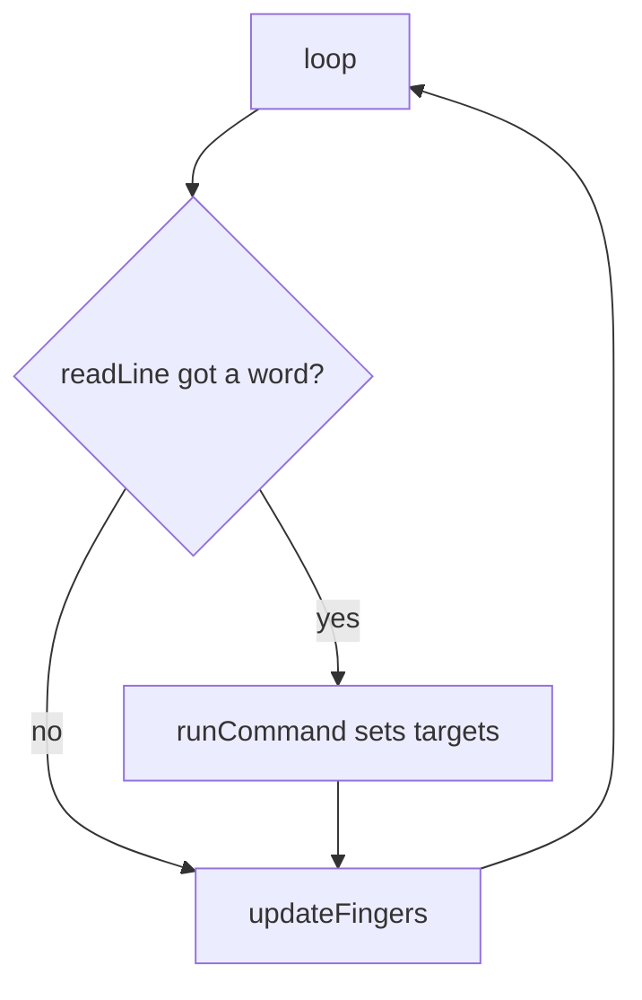

# Tutorial 5: Typed Commands: A Hand That Obeys Words

> **Time**: 60 min | **Difficulty**: Beginner
> **Prerequisites**: [Tutorial 2](../02-first-code/lesson.md), [Tutorial 4](../04-the-hand/lesson.md)

## What You'll Learn

- How to read a typed line and clean it so it matches.
- How a command table maps words to gesture functions.
- How to move fingers a few degrees at a time so motion is smooth.

## Why This Matters

:::hook {kind="problem"}
Type "point" into the Serial Monitor and the hand snaps to a pose so hard that it rattles and the board almost resets. Same pose, same code, but five servos jumped at once. Today the hand gets manners, and the code gets the exact shape the voice commands will use in lesson 8.
:::

**Key idea: whatever the source of a command, typed or spoken, it becomes a clean word that is looked up in one table, and the hand moves toward its target a little at a time.**

Three points support it:
1. Input arrives messy, so you clean it before comparing.
2. A table of word and function pairs scales without a tangle of ifs.
3. Small steps over time are gentler and safer than one jump.

## Walkthrough

### Step 1: Read and clean a line

:::note {kind="key"}
Cleaning a line: removing spaces and hidden end-of-line characters and changing capitals to lower case, so any version of the same word becomes one standard form.
:::

:::analogy {concept="c14"}
title: A mail sorter who straightens each envelope
boundary: A person can guess a smudged address; the board matches character by character, so it needs exact text.
---
Before sorting, the mail clerk smooths the envelope and reads the address. "Point", " point" and "POINT" are all straightened into "point".
:::

:::example {concept="c14" level="minimal"}
title: A readLine helper
---
```cpp
// hand_commands.ino
// The helper that reads and cleans one typed line.
bool readLine(String &out) {
  if (Serial.available() == 0) return false;     // nothing arrived
  out = Serial.readStringUntil('\n');            // up to the Enter key
  out.trim();                                    // remove spaces and \r
  out.toLowerCase();                             // POINT -> point
  return out.length() > 0;                       // empty lines don't count
}
```
`String &out` means the function fills in the String you give it. It returns true only when a real word was read.
:::

:::checkpoint {concept="c14"}
question: What does readLine return if you press Enter on a blank line, and why is that useful?
expected: false. An empty line is not a command, so the main code skips it without any special case.
---
:::

### Step 2: A command table

This step is the main path: the voice hand in lesson 8 reuses this exact table, so we build it in small pieces.

:::note {kind="key"}
Command table: a list of rows, each pairing a command word with the function to run, so one loop can find and run any command.
:::

:::analogy {concept="c15"}
title: A phone book
boundary: A phone book maps a name to a number you then dial; the table maps a word to a function the program then calls.
---
You look up "point" and find "pointHand". Adding a person adds one line; nothing else changes.
:::

First the plain way, which works but grows with every command:

```cpp
// plain_commands.ino
// The if / else version from lesson 2, now calling hand functions.
if (word == "open") openHand();
else if (word == "close") closeHand();
else if (word == "point") pointHand();
```

Two new ideas turn this into a table:
- A **struct** is a labelled bundle: `Command` holds a word and a function together, like an index card with two lines.
- Writing a function's name **without** parentheses means "this function itself" (the recipe card), not "do it now". A variable that holds such a card is declared `void (*run)();`. Read it aloud as: "run is a card for a function that takes nothing and returns nothing". Later `run()` does it.

```cpp
// card_demo.ino
void sayHi() { Serial.println("hi"); }

void setup() {
  Serial.begin(115200);
  void (*card)() = sayHi;   // store the card, nothing runs yet
  card();                   // now it runs: prints hi
}
void loop() { }
```

A table is just a row of such cards, each labelled with its word.

:::checkpoint {concept="c15"}
question: In card_demo.ino, what is printed if you delete the line `card();` and why?
expected: Nothing. Storing the function name only keeps the card; the parentheses in card() are what run it.
---
:::

:::note {kind="tip"}
Practice drill before the real table: in card_demo.ino add a second function `sayBye()` and a second card variable, and call both. Once you can do that, a table is only a row of labelled cards. If the struct syntax still feels heavy, the if / else chain above also works in lesson 8: write `if (strcmp(word, "open") == 0) { openHand(); return true; }` for each word inside runCommand.
:::

:::example {concept="c15" level="realistic"}
title: The table and the lookup
---
```cpp
// hand_commands.ino
// The command table and the lookup that runs a command.
struct Command {
  const char *name;     // the word
  void (*run)();        // the function to call (no inputs, no result)
};

const Command COMMANDS[] = {
  {"open",  openHand},
  {"close", closeHand},
  {"point", pointHand},
};
const int COMMAND_COUNT = sizeof(COMMANDS) / sizeof(COMMANDS[0]);

bool runCommand(const String &word) {
  for (int i = 0; i < COMMAND_COUNT; i++) {
    if (word == COMMANDS[i].name) {
      COMMANDS[i].run();             // now the parentheses call it
      return true;
    }
  }
  return false;                       // word not found
}
```
:::

:::checkpoint {concept="c15"}
question: To add a new peace command, which two things do you write?
expected: A peaceHand() function, and one new row {"peace", peaceHand} in the table.
---
:::

### Step 3: Smooth movement

:::note {kind="key"}
Smooth movement: keeping a current angle and a target angle per finger, and every few milliseconds moving the current angle a few degrees toward the target.
:::

:::analogy {concept="c16"}
title: A cruise-control car
boundary: A car has weight that makes it ease in naturally; our steps are fixed, so it starts and stops abruptly unless you add easing.
---
You do not teleport to the destination. You tell the car the target and it eases toward it, a little each moment.
:::

**Try it now:** add a `peace` row to the table and type it.

`delay()` would freeze everything (including Serial reading) while it waits. So we ask the clock instead: `millis()` is the number of milliseconds since power-on. Every 15 ms we take one step.

:::example {concept="c16" level="realistic"}
title: The finished typed-command sketch
---
```cpp
// hand_commands.ino
#include <ESP32Servo.h>

const int FINGERS = 5;
const int PINS[FINGERS]         = {13, 14, 25, 26, 27};
int OPEN_ANGLE[FINGERS]         = {30, 30, 30, 30, 30};      // paste your calibrated numbers
int CLOSED_ANGLE[FINGERS]       = {150, 150, 150, 150, 150}; // paste your calibrated numbers

const int STEP_DEG = 2;               // degrees per step
const unsigned long STEP_MS = 15;     // time between steps

Servo servos[FINGERS];
int currentAngle[FINGERS];
int targetAngle[FINGERS];
unsigned long lastStep = 0;

void setFinger(int i, bool open) {
  targetAngle[i] = open ? OPEN_ANGLE[i] : CLOSED_ANGLE[i];   // set a target only
}
void openHand()  { for (int i = 0; i < FINGERS; i++) setFinger(i, true); }
void closeHand() { for (int i = 0; i < FINGERS; i++) setFinger(i, false); }
void pointHand() { for (int i = 0; i < FINGERS; i++) setFinger(i, i == 1); }

void updateFingers() {
  if (millis() - lastStep < STEP_MS) return;     // not time yet
  lastStep = millis();
  for (int i = 0; i < FINGERS; i++) {
    if (currentAngle[i] < targetAngle[i]) {
      currentAngle[i] = min(currentAngle[i] + STEP_DEG, targetAngle[i]);
    } else if (currentAngle[i] > targetAngle[i]) {
      currentAngle[i] = max(currentAngle[i] - STEP_DEG, targetAngle[i]);
    }
    servos[i].write(currentAngle[i]);
  }
}

struct Command { const char *name; void (*run)(); };
const Command COMMANDS[] = {
  {"open", openHand}, {"close", closeHand}, {"point", pointHand},
};
const int COMMAND_COUNT = sizeof(COMMANDS) / sizeof(COMMANDS[0]);

bool runCommand(const String &word) {
  for (int i = 0; i < COMMAND_COUNT; i++) {
    if (word == COMMANDS[i].name) { COMMANDS[i].run(); return true; }
  }
  return false;
}

bool readLine(String &out) {
  if (Serial.available() == 0) return false;
  out = Serial.readStringUntil('\n');
  out.trim();
  out.toLowerCase();
  return out.length() > 0;
}

void setup() {
  Serial.begin(115200);
  for (int i = 0; i < FINGERS; i++) {
    servos[i].attach(PINS[i], 500, 2400);
    currentAngle[i] = OPEN_ANGLE[i];
    targetAngle[i]  = OPEN_ANGLE[i];
    servos[i].write(currentAngle[i]);
  }
  Serial.println("Type: open, close or point");
}

void loop() {
  String word;
  if (readLine(word)) {
    if (runCommand(word)) Serial.println("ok: " + word);
    else Serial.println("unknown: " + word);
  }
  updateFingers();     // runs every pass; moves only when 15 ms have passed
}
```
:::

:::chart {type="bar" title="Time for a 120 degree move at different step sizes (15 ms per step)" x="Step (degrees)" y="Seconds" alt="Bigger steps finish sooner: 1 degree takes 1.8 seconds, 2 degrees 0.9, 4 degrees 0.45, 8 degrees 0.23." source="illustrative"}
1 degree, 1.8
2 degrees, 0.9
4 degrees, 0.45
8 degrees, 0.23
:::

:::widget {id="stepping" kind="simulation" height="260" title="Stepping toward a target" concept="c16" alt="Sliders set the step size and the time between steps; a bar moves from the current angle toward a target of 150 degrees, and the page shows how long the move takes."}
```css
.track { height: 18px; background: var(--line); border-radius: 9px; position: relative; margin: 8px 0; }
.fill { height: 18px; background: var(--accent); border-radius: 9px; width: 0; }
label { display: flex; justify-content: space-between; color: var(--dim); margin-top: 8px; }
input[type=range] { width: 100%; accent-color: var(--accent); }
button { margin-top: 8px; padding: 6px 12px; }
.out { margin-top: 8px; color: var(--text); }
```
```html
<div class="track" aria-hidden="true"><div class="fill" id="fill"></div></div>
<label for="st">Step <b id="stv">2</b> degrees</label>
<input id="st" type="range" min="1" max="20" value="2">
<label for="ms">Time between steps <b id="msv">15</b> ms</label>
<input id="ms" type="range" min="5" max="60" value="15">
<button id="go" type="button">Move from 30 to 150</button>
<p class="out" id="out" role="status"></p>
```
```js
let timer = null;
function totalSeconds() {
  const st = document.getElementById('st').valueAsNumber;
  const ms = document.getElementById('ms').valueAsNumber;
  if (!Number.isFinite(st) || !Number.isFinite(ms)) return 0;
  return Math.ceil(120 / st) * ms / 1000;
}
function labels() {
  document.getElementById('stv').textContent = document.getElementById('st').value;
  document.getElementById('msv').textContent = document.getElementById('ms').value;
  document.getElementById('out').textContent = 'A 120 degree move takes about ' + totalSeconds().toFixed(2) + ' seconds.';
}
function run() {
  if (timer) clearInterval(timer);
  const st = document.getElementById('st').valueAsNumber;
  const ms = document.getElementById('ms').valueAsNumber;
  if (!Number.isFinite(st) || !Number.isFinite(ms)) return;
  let angle = 30;
  const fill = document.getElementById('fill');
  fill.style.width = '0%';
  timer = setInterval(function () {
    angle = Math.min(angle + st, 150);
    fill.style.width = ((angle - 30) / 120 * 100) + '%';
    if (angle >= 150) clearInterval(timer);
  }, ms);
}
function setup() {
  document.getElementById('st').addEventListener('input', labels);
  document.getElementById('ms').addEventListener('input', labels);
  document.getElementById('go').addEventListener('click', run);
  labels();
}
```
```js-run
setup();
```
:::

:::checkpoint {concept="c16"}
question: With STEP_DEG = 4 and STEP_MS = 15, about how long does a 120 degree move take?
expected: 30 steps of 15 ms, about 0.45 seconds.
---
:::

:::diagram
title: One pass through loop()
---

:::

## Common Mistakes

:::mistake {concept="c14" title="Comparing without trimming"}
::wrong
```cpp
// hand_commands.ino
String word = Serial.readStringUntil('\n');
if (word == "point") { pointHand(); }   // fails when the monitor sends \r\n
```
::right
```cpp
// hand_commands.ino
word.trim();
```
::why
A hidden \r at the end makes "point\r" a different string from "point".
:::

:::mistake {concept="c15" title="Adding parentheses inside the table"}
::wrong
```cpp
// hand_commands.ino
{"point", pointHand()},   // calls the function while the table is built
```
::right
```cpp
// hand_commands.ino
{"point", pointHand},
```
::why
With parentheses the code runs the function and tries to store its (empty) result. Without them the table stores the function so it can be run later.
:::

:::mistake {concept="c16" title="Using delay() in loop()"}
::wrong
```cpp
// hand_commands.ino
for (int a = 30; a < 150; a += 2) { servo.write(a); delay(15); }
```
::right
```cpp
// hand_commands.ino
updateFingers();   // one small step per call, no waiting
```
::why
While delay() sleeps the board cannot read the next command or listen to the microphone, which we need later.
:::

## Try It Yourself

:::challenge
title: Speed commands
---
::task
Add commands `fast` and `slow` that change how quickly the hand moves, and a command `peace` that opens index and middle only.
::hint
Make STEP_DEG a variable instead of const, and write small functions fastMode() and slowMode() that set it to 4 and 1.
::solution
```cpp
// hand_commands.ino
// Changes: stepDeg replaces the constant STEP_DEG.
int stepDeg = 2;
void fastMode() { stepDeg = 4; }
void slowMode() { stepDeg = 1; }
void peaceHand() { for (int i = 0; i < FINGERS; i++) setFinger(i, i == 1 || i == 2); }

const Command COMMANDS[] = {
  {"open", openHand}, {"close", closeHand}, {"point", pointHand},
  {"peace", peaceHand}, {"fast", fastMode}, {"slow", slowMode},
};
// in updateFingers(): use stepDeg where STEP_DEG was
```
:::

1. Run hand_commands.ino and type each command; watch the hand move smoothly.
2. Try "POINT", " point " and "pnt" to see the clean-up and the unknown message.
3. Change STEP_DEG and STEP_MS and find the speed that looks most natural.

:::quiz {ref="q3"}
:::

:::quiz {ref="q5"}
:::

## Key Takeaways

:::takeaways
- Clean every incoming line (trim, lower-case, skip empties) before matching it.
- A command table pairs words with functions; adding a command is one row.
- Keep a current and a target angle per finger and step toward it with millis(), never delay().
- The typed-word path is the same shape the voice path will use.
:::

We come back to the command table in [lesson 8: The Voice-Controlled Hand](../08-voice-hand/lesson.md), where the words come from a trained voice model but the same runCommand finds the function.

## What's Next

The hand obeys your keyboard. Over the next two lessons it learns to listen. In [lesson 6: The Microphone](../06-microphone/lesson.md) you wire a microphone and learn what sound looks like to a computer.

:::bridge {to="02-first-code"}
We met Serial input and if / else in [lesson 2: Your First Code](../02-first-code/lesson.md): read a typed word and pick an action. In this lesson we went further: clean the input properly, replace the if chain with a table, and let the action be one of the hand's gesture functions from [lesson 4: The Hand](../04-the-hand/lesson.md).
:::

:::bridge {to="06-microphone"}
Words come in as text now. Next we capture sound itself, a stream of numbers.
:::

:::homework {kind="build"}
Add three commands of your own, such as "rock", "peace", "three", and one "wave" that cycles the hand open and closed twice. Think about how a wave can work without delay(): it needs a small sequence that checks `millis()`.
:::

## Further Reading

:::docs
title: Arduino String reference
url: https://www.arduino.cc/reference/en/language/variables/data-types/stringobject/
---
The functions used here (trim, toLowerCase, length); this lesson shows how to combine them to clean a command.
:::

:::docs
title: Arduino millis()
url: https://www.arduino.cc/reference/en/language/functions/time/millis/
---
The clock the smooth-movement code reads; the page also explains when the count wraps around.
:::
