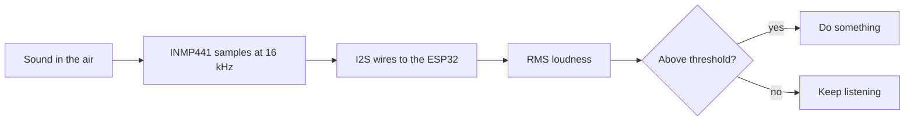

# Tutorial 6: The Microphone: Sound as Numbers

> **Time**: 60 min | **Difficulty**: Beginner
> **Prerequisites**: [Tutorial 2](../02-first-code/lesson.md), [Tutorial 3](../03-servo-motion/lesson.md), [Tutorial 5](../05-typed-commands/lesson.md)

## What You'll Learn

- How sound becomes a stream of numbers.
- How to wire and read an I2S digital microphone.
- How to measure loudness and set a sensible threshold.

## Why This Matters

:::hook {kind="surprise"}
To a computer, your voice is not words. It is 16,000 numbers every second, swinging up and down. Before any recognition, we can already do something useful with those numbers: measure how loud it is, and move a finger when you clap.
:::

**Key idea: a microphone gives the ESP32 a stream of numbers; loudness is a single number you can calculate from them, and comparing it to a threshold makes the first, crude "listening" decision.**

Three points support it:
1. Sound is sampled: many measurements per second.
2. An I2S microphone sends those measurements digitally over three signal wires.
3. Loudness plus a threshold is the simplest trigger, and the first idea behind confidence in lesson 7.

## Walkthrough

### Step 1: Sound as numbers

:::note {kind="key"}
Sampling: measuring the air pressure at the microphone many times per second; each measurement is a sample, and the number of samples per second is the sample rate.
:::

:::analogy {concept="c17"}
title: A flip-book of a wave
boundary: A flip-book is made of pictures; samples are single numbers, and the more per second, the closer to the true wave.
---
Take a photo of a moving wave 16,000 times a second. Each photo is one number: how far the pressure is from still air. Played back in order, the numbers redraw the sound.
:::

A silent room gives samples near zero. A loud sound swings them far above and below zero. For speech, **16,000 samples per second (16 kHz)** is enough, because most of what makes words recognisable lives below 8 kHz and the rate needs to be about double the highest frequency.

:::example {concept="c17" level="minimal"}
title: A made-up second of sound
---
```text
# samples.txt
quiet room : 3, -2, 5, -4, 1, -3, 2 ...        (small swings)
a clap     : 4100, -6200, 8900, -7700, 3000 ... (big swings)
```
The size of the swings, not their sign, tells you how loud it is.
:::

:::checkpoint {concept="c17"}
question: If you record for half a second at 16 kHz, how many samples do you get?
expected: 8,000 samples (16,000 times 0.5).
---
:::

### Step 2: Wire the I2S microphone

:::note {kind="key"}
I2S: a three-wire digital audio link; the bit clock (BCLK) times each bit, word select (WS) marks the start of each sample, and the data line (SD) carries the sample from the microphone to the ESP32.
:::

:::analogy {concept="c18"}
title: A conveyor belt with a metronome
boundary: A belt needs just one rhythm; I2S has two clock lines because it needs both a bit rhythm and a "new sample begins" mark.
---
The microphone puts one bit of the sample on the belt for every tick of the bit clock. The word-select line says "a new number starts now".
:::

An **INMP441** breakout is a tiny digital microphone. It runs on **3.3 V**.

| INMP441 pin | Connect to |
|---|---|
| VDD | ESP32 3.3V |
| GND | ESP32 GND (the same ground as the servo supply) |
| SCK | GPIO32 (bit clock) |
| WS | GPIO33 (word select) |
| SD | GPIO34 (data in; this pin is input only, which is perfect) |
| L/R | GND (selects the left channel) |

:::note {kind="warning"}
Never connect the microphone's VDD to 5 V. Leave no pin floating: L/R must go to GND or 3.3 V. Keep the microphone away from the servos' wires, which add buzzing noise; a bit of distance helps a lot.
:::

:::example {concept="c18" level="realistic"}
title: Read and print the raw samples
---
```cpp
// mic_raw.ino
#include <ESP_I2S.h>

const int BCLK_PIN = 32;
const int WS_PIN   = 33;
const int DATA_PIN = 34;

I2SClass i2s;

void setup() {
  Serial.begin(115200);
  i2s.setPins(BCLK_PIN, WS_PIN, -1, DATA_PIN);   // bclk, ws, data out (unused), data in
  // 16 kHz, the INMP441 sends 24-bit samples inside 32-bit slots
  if (!i2s.begin(I2S_MODE_STD, 16000, I2S_DATA_BIT_WIDTH_32BIT, I2S_SLOT_MODE_MONO, I2S_STD_SLOT_LEFT)) {
    Serial.println("I2S failed to start");
    while (true) delay(1000);
  }
}

void loop() {
  int32_t raw[16];
  size_t got = i2s.readBytes((char *)raw, sizeof(raw));
  for (size_t i = 0; i < got / 4; i++) {
    Serial.println(raw[i] >> 16);     // keep the top 16 bits: -32768..32767
  }
}
```
Why `>> 16`? The microphone's numbers are huge, so `>> 16` scales each one down to a normal range (-32768 to 32767), like dropping the last digits of 4721 to get 47. You can use the line as given. Tested with Arduino-ESP32 core 3.x; with an older core the ESP_I2S library is missing, so update the board package.

Open Tools > Serial Plotter and clap near the microphone. You should see the line jump. The I2S functions have changed between Arduino-ESP32 versions; if the compiler complains, check the I2S page linked below for your version.
:::

:::checkpoint {concept="c18"}
question: Why does the code shift each raw sample right by 16 instead of printing it as it is?
expected: The sample arrives in a 32-bit box whose useful sound information is in the top bits; shifting right gives a normal 16-bit-sized number (-32768 to 32767) and drops the noisy bottom bits.
---
:::

:::checkpoint {concept="c18"}
question: Which pin carries the sound samples, and which two pins only control timing?
expected: SD (GPIO34) carries the samples. SCK/BCLK (GPIO32) is the bit clock and WS (GPIO33) is the word select; both only control timing.
---
:::

### Step 3: Loudness and a threshold

:::note {kind="key"}
Loudness (RMS): the square root of the average of the squared samples; it turns hundreds of swinging numbers into one number for "how big are the swings". A threshold is a line above which that number counts as an event.
:::

:::analogy {concept="c19"}
title: A doorman with a line on the wall
boundary: A doorman judges by eye; our line is a fixed number, so a noisy room needs a higher line.
---
Anyone taller than the line gets in. Noise above the threshold counts as a "clap"; everything below is ignored.
:::

:::math {track="mathematical"}
::formula
$$ \text{RMS} = \sqrt{\frac{1}{N}\sum_{i=1}^{N} s_i^{2}} $$
::meaning
Square each sample so negatives become positive, average them, and take the square root. Louder sound gives a bigger number.
:::

:::widget {id="threshold" kind="simulation" height="360" title="Pick a threshold" concept="c19" alt="A row of loudness bars for a quiet room, speech and claps. A slider moves the threshold line, and the page counts how many bars trigger and shows whether any quiet-room bar triggers by mistake."}
```css
.bars { display: flex; align-items: flex-end; gap: 3px; height: 130px; border-bottom: 1px solid var(--line); position: relative; }
.bars span { flex: 1; background: var(--dim); border-radius: 2px 2px 0 0; }
.bars span.hit { background: var(--accent); }
.line { position: absolute; left: 0; right: 0; border-top: 2px dashed var(--text); }
label { display: flex; justify-content: space-between; color: var(--dim); margin-top: 10px; }
input[type=range] { width: 100%; accent-color: var(--accent); }
.out { margin-top: 8px; color: var(--text); }
```
```html
<div class="bars" id="bars" aria-hidden="true"><div class="line" id="line"></div></div>
<label for="th">Threshold <b id="thv">3000</b></label>
<input id="th" type="range" min="100" max="10000" step="100" value="3000">
<p class="out" id="out" role="status"></p>
```
```js
const LEVELS = [180,220,150,260,200,2200,3100,2600,1800,240,190,9000,8200,300,210,170,2900,3500,2400,220,9400,7800,260,190];
const KINDS  = ['q','q','q','q','q','s','s','s','s','q','q','c','c','q','q','q','s','s','s','q','c','c','q','q'];
function draw() {
  const th = document.getElementById('th').valueAsNumber;
  if (!Number.isFinite(th)) return;
  const bars = document.getElementById('bars');
  bars.querySelectorAll('span').forEach(function (n) { n.remove(); });
  let claps = 0, falseAlarms = 0, speech = 0;
  LEVELS.forEach(function (v, i) {
    const s = document.createElement('span');
    s.style.height = Math.min(100, v / 100) + '%';
    if (v > th) {
      s.className = 'hit';
      if (KINDS[i] === 'c') claps++;
      else if (KINDS[i] === 'q') falseAlarms++;
      else speech++;
    }
    bars.appendChild(s);
  });
  document.getElementById('line').style.bottom = Math.min(100, th / 100) + '%';
  document.getElementById('thv').textContent = th;
  document.getElementById('out').textContent =
    'Claps caught: ' + claps + ' of 4. Speech triggers: ' + speech + '. Quiet-room false alarms: ' + falseAlarms + '.';
}
function setup() {
  document.getElementById('th').addEventListener('input', draw);
  draw();
}
```
```js-run
setup();
```
:::

**Try it now:** drag the slider to 500, then 9500, and note what each extreme does. Then drag it to 2000 and look at the speech bars: spoken words such as "open" and "close" read about the same level (around 2000 to 3500), between the quiet room and the claps. Loudness cannot tell them apart.

Move the line until you catch all four claps but zero false alarms. Notice that speech sits in the middle: a plain threshold cannot tell "close" from "open" from a cough. That is exactly why lesson 7 uses a trained model.

:::example {concept="c19" level="challenging"}
title: A loudness meter and a clap trigger
---
```cpp
// mic_clap.ino
#include <ESP_I2S.h>

const int BCLK_PIN = 32;
const int WS_PIN   = 33;
const int DATA_PIN = 34;
const float THRESHOLD = 3000;           // tune this using your own room
const unsigned long COOLDOWN_MS = 800;  // ignore claps right after a clap

I2SClass i2s;
unsigned long lastClap = 0;

float readLevel() {
  int32_t raw[256];
  size_t got = i2s.readBytes((char *)raw, sizeof(raw));
  size_t n = got / 4;
  if (n == 0) return 0;
  double mean = 0;
  for (size_t i = 0; i < n; i++) mean += (raw[i] >> 16);
  mean /= n;                               // remove the constant offset
  double sum = 0;
  for (size_t i = 0; i < n; i++) {
    double d = (raw[i] >> 16) - mean;
    sum += d * d;
  }
  return sqrt(sum / n);                    // RMS
}

void setup() {
  Serial.begin(115200);
  i2s.setPins(BCLK_PIN, WS_PIN, -1, DATA_PIN);
  if (!i2s.begin(I2S_MODE_STD, 16000, I2S_DATA_BIT_WIDTH_32BIT, I2S_SLOT_MODE_MONO, I2S_STD_SLOT_LEFT)) {
    Serial.println("I2S failed to start");
    while (true) delay(1000);
  }
}

void loop() {
  float level = readLevel();
  Serial.println(level);                   // watch it in the Serial Plotter
  if (level > THRESHOLD && millis() - lastClap > COOLDOWN_MS) {
    lastClap = millis();
    Serial.println("CLAP");
  }
}
```
Each block of 256 samples takes 16 ms, so you get about 60 readings per second. The 800 ms cooldown stops one clap from firing many times.
:::

:::checkpoint {concept="c19"}
question: Room noise reads about 250 and your clap about 9000. Why not set the threshold to 300 or to 9000?
expected: At 300 normal noise bumps it and fires falsely; at 9000 a slightly quieter clap is missed. Pick a value in the gap, like 3000.
---
:::

:::diagram
title: From air to a decision
---

:::

:::note {kind="warning"}
A clap is a loud, sudden sound and servo motors are noisy too. If the hand triggers itself, increase THRESHOLD, move the microphone away from the servos, or add a few hundred milliseconds of cooldown.
:::

## Common Mistakes

:::mistake {concept="c17" title="Assuming silence reads zero"}
::wrong
Setting the threshold to 5 because "quiet is zero".
::right
Print the level in a quiet room first, then set the threshold well above it.
::why
Every microphone and room has a noise floor, often in the hundreds.
:::

:::mistake {concept="c18" title="Leaving L/R floating"}
::wrong
Only five wires connected; L/R left unconnected. The signal is zero or comes and goes.
::right
L/R tied to GND, matching I2S_STD_SLOT_LEFT in the code.
::why
The L/R pin chooses which channel the mic speaks on. Floating, its choice is random.
:::

:::mistake {concept="c19" title="No cooldown"}
::wrong
```cpp
// mic_clap.ino
if (level > THRESHOLD) Serial.println("CLAP");   // prints many times per clap
```
::right
```cpp
// mic_clap.ino
if (level > THRESHOLD && millis() - lastClap > COOLDOWN_MS) { /* ... */ }
```
::why
A clap lasts longer than one 16 ms block, so many blocks in a row are above the threshold. The cooldown counts them as one event.
:::

## Try It Yourself

:::challenge
title: Clap to change pose
---
::task
Add the clap detection to your hand_commands.ino from lesson 5. Each clap should toggle between openHand() and closeHand(). Keep typed commands working too.
::hint
Add a bool handOpen; call readLevel() in loop(); on a clap, flip handOpen and call the right function. Keep updateFingers() in loop().
::solution
```cpp
// hand_commands.ino
// Additions: put these in the sketch, and call checkClap() before updateFingers() in loop().
bool handOpen = true;

void checkClap() {
  float level = readLevel();
  if (level > THRESHOLD && millis() - lastClap > COOLDOWN_MS) {
    lastClap = millis();
    handOpen = !handOpen;
    if (handOpen) openHand(); else closeHand();
  }
}
```
:::

1. Wire the microphone and run mic_raw.ino with the Serial Plotter open.
2. Record the quiet-room level, a spoken "close" and a clap with mic_clap.ino. Write all three numbers down.
3. Pick a threshold using the widget and then check it on the real board.

:::quiz {ref="q3"}
:::

:::quiz {ref="q6"}
:::

## Key Takeaways

:::takeaways
- Sound is a stream of samples; 16 kHz is enough for speech.
- An I2S mic needs power (3.3 V), ground, a bit clock, a word select, a data line and L/R tied to a level.
- RMS turns a block of samples into one loudness number.
- A threshold in the gap between noise and event, plus a cooldown, gives a simple, reliable trigger.
:::

We come back to the threshold in [lesson 7: Keyword Spotting](../07-keyword-spotting/lesson.md), where the model's confidence score is a smarter version of the same idea, and in [lesson 8: The Voice-Controlled Hand](../08-voice-hand/lesson.md), where the cooldown returns.

## What's Next

Loudness cannot tell one word from another. In [lesson 7: Keyword Spotting](../07-keyword-spotting/lesson.md) you train a small model to recognise "open", "close" and "point".

:::bridge {to="03-servo-motion"}
We met GPIO pins and the shared ground in [lesson 3: Servo Motion](../03-servo-motion/lesson.md): pins carry signals, and every part must share one ground. In this lesson we went further: three pins carry a digital audio stream into the board instead of a pulse out of it, and the microphone joins the same ground as the servo supply.
:::

:::bridge {to="07-keyword-spotting"}
You can hear that something happened. Next you teach the board which word it heard.
:::

:::homework {kind="practice"}
Record in a table the level of: silence, normal talking at arm's length, saying "close" loudly, a clap, and the servos moving. Which two are closest together? That pair is hard to separate by loudness alone, and the answer sets up lesson 7.
:::

## Further Reading

:::docs
title: Arduino-ESP32 I2S API
url: https://docs.espressif.com/projects/arduino-esp32/en/latest/api/i2s.html
---
The official description of the I2S class used in these sketches; check it if your core version has different function names.
:::

:::docs
title: INMP441 datasheet (TDK InvenSense)
url: https://invensense.tdk.com/products/digital/inmp441/
---
The microphone's electrical limits and data format; this lesson uses its 3.3 V supply and 24-bit-in-32-bit output.
:::
