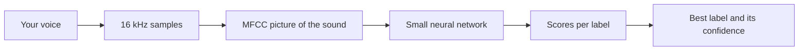

# Tutorial 7: Keyword Spotting: Teaching the Board Three Words

> **Time**: 60 min | **Difficulty**: Beginner
> **Prerequisites**: [Tutorial 6](../06-microphone/lesson.md)

## What You'll Learn

- What classification means, and why a few known words are easy to recognise.
- How to record and label your own examples.
- How to train a small model and read its confidence scores on the ESP32.

## Why This Matters

:::hook {kind="problem"}
In lesson 6 a quiet room read about 200, speech about 2000 to 3500 and a clap about 9000, so speech sits in the middle: "open" and "close" read equally loud, so loudness cannot tell them apart. The board needs to know the shape of a word. You will teach it that by example, the way you would teach a child to recognise three animals: show many pictures, name each one.
:::

**Key idea: the board does not understand speech; it picks the best-matching label out of a short list, and it also reports how sure it is, so the hand can refuse to act when it is unsure.**

Three points support it:
1. Classification means choosing one label from a fixed list.
2. The model is only as good as its labelled examples.
3. The confidence score is the new, smarter threshold.

## Walkthrough

### Step 1: Classification

:::note {kind="key"}
Classification: given an input, such as one second of sound, a model chooses one label from a fixed list of labels.
:::

:::analogy {concept="c20"}
title: A sorting hat with five hooks
boundary: A hat looks at a person; the model looks at a picture of the sound's frequencies, never at meaning.
---
There are five hooks: open, close, point, noise and unknown. Each sound is dropped on the hook it most resembles.
:::

How the sound becomes something the model can compare: the one-second window of 16,000 samples is turned into a small picture, an **MFCC**, showing how much energy there is at different pitches over time. Different words make different pictures. A rough text sketch (time runs left to right, low pitch at the bottom, # means strong energy):

```text
# mfcc-sketch.txt
"open"            "close"
high |  .  .  #  .      high |  #  .  .  .
mid  |  .  #  #  .      mid  |  #  #  .  .
low  |  #  #  .  .      low  |  .  #  #  #
```

The model, a tiny neural network, learns the patterns in those pictures.

:::diagram
title: From voice to label
---

:::

:::example {concept="c20" level="minimal"}
title: One clip, five scores
---
```text
# classification-result.txt
clip: you say "close"
open: 0.04   close: 0.91   point: 0.03   noise: 0.01   unknown: 0.01
best label: close
```
The model never writes the word "close"; it only says which of its five labels fits best.

**Try it now:** a clip of a door slam is scored open 0.10, close 0.12, point 0.08, noise 0.62, unknown 0.08. Predict the best label before reading on: it is noise, and the hand should do nothing.
:::

:::checkpoint {concept="c20"}
question: Why can this model recognise open, close and point on a small ESP32 but not take dictation?
expected: It only chooses among a handful of known labels, so the model is tiny; dictation needs a vocabulary of thousands of words and far more memory and computation.
---
:::

### Step 2: Build the training data

:::note {kind="key"}
Training data: a collection of examples, each a sound clip with a label, from which the model learns what each label sounds like.
:::

:::analogy {concept="c21"}
title: Flash cards for a student
boundary: A student can reason about a new card; the model only matches patterns it has already seen.
---
You show the card and say the answer, many times. If every card is in your voice, the student will be confused by someone else's.
:::

We use **Edge Impulse**, a free (for hobby use) web tool that records, trains and exports a library for the ESP32. The screens change over time, so follow the current docs linked below for the exact buttons.

1. Create an account and a project named "robot hand".
2. Open **Data acquisition** and record 1-second clips with your computer or phone microphone. Record **80 clips per label**. That takes about 20 minutes with a phone or laptop. (40 each is a bare minimum that will probably work only for your own voice.) If the screens differ from these steps, follow the current Edge Impulse keyword-spotting tutorial.
   - **open**: 80 clips
   - **close**: 80 clips
   - **point**: 80 clips
   - **noise**: 80 clips (room hum, typing, the servos running, a door, music)
   - **unknown**: 80 clips (other words: "hello", "banana", "yes")
3. Vary your voice: near and far, loud and soft, fast and slow. Add a friend or two if you can.
4. Create an **impulse**: audio (MFCC) processing block, then a classification block, with a 1000 ms window at 16 kHz.
5. Click through **Generate features** and **Classifier**, and train. Look at the accuracy and the confusion matrix, the table that shows which labels get mixed up. Aim for 85% or better before you move on.

Short on time? Time-box it: record 40 clips per label now, train, and finish the lesson; add the other 40 as homework. If Edge Impulse gives you trouble, you can still finish lesson 8 with typed commands.

:::example {concept="c21" level="minimal"}
title: A good recording plan
---
```text
# recording-plan.txt
open    : 20 clips close to the mic, 10 from 1 m away, 10 quietly
close   : same plan
point   : same plan
noise   : 10 room, 10 servos moving, 10 typing, 10 talking about other things
unknown : 40 other short words
```
Balanced counts matter: if one label has far more clips, the model leans toward it.
:::

:::example {concept="c21" level="realistic"}
title: Reading a confusion matrix
---
```text
# confusion-matrix.txt
            open   close  point  noise  unknown
open        92%     3%     3%     0%     2%
close        4%    90%     2%     0%     4%
point        6%     1%    88%     0%     5%
noise        0%     0%     0%    98%     2%
unknown      2%     4%     3%     4%    87%
```
Each row is what you said and each column is what the model heard. Here "point" is mistaken for "open" 6% of the time, so record more clean "point" clips and vary them.
:::

:::checkpoint {concept="c21"}
question: Why record the servos running as a noise sample?
expected: Because the servos will be running when the hand listens; the model must learn that their sound is not a command.
---
:::

### Step 3: Confidence

:::note {kind="key"}
Confidence score: a number from 0 to 1 that the model gives each label for a clip; the best label's score tells how sure the model is.
:::

:::analogy {concept="c22"}
title: A friend who says "I'm 90% sure"
boundary: A person's 90% is a feeling; the model's score is a calculated number and can be confidently wrong.
---
Someone calls out a word from another room. "I think they said open... maybe 60%". At 60% you would ask again. At 95% you would just open the door.
:::

The scores add up to about 1. Example for one clip: open 0.04, close 0.91, point 0.03, noise 0.01, unknown 0.01 means "close", confidence 0.91.

:::widget {id="confidence" kind="simulation" height="400" title="The confidence gate" concept="c22" alt="A slider sets the confidence needed before the hand acts. A table of twelve sounds shows what was said, what the model heard, its confidence, and whether the hand acts; totals show correct moves, wrong moves and missed commands."}
```css
table { width: 100%; border-collapse: collapse; font-size: 13px; }
td, th { padding: 3px 6px; border-bottom: 1px solid var(--line); text-align: left; color: var(--text); }
th { color: var(--dim); }
tr.good td:last-child { color: var(--accent); font-weight: 700; }
tr.bad td:last-child { color: #d9534f; font-weight: 700; }
label { display: flex; justify-content: space-between; color: var(--dim); margin: 6px 0; }
input[type=range] { width: 100%; accent-color: var(--accent); }
.sum { margin-top: 8px; color: var(--text); }
```
```html
<label for="gate">Act only if confidence is at least <b id="gv">0.80</b></label>
<input id="gate" type="range" min="0.3" max="0.99" step="0.01" value="0.8">
<table><thead><tr><th>You said</th><th>Model heard</th><th>Conf.</th><th>Hand</th></tr></thead><tbody id="rows"></tbody></table>
<p class="sum" id="sum" role="status"></p>
```
```js
const SOUNDS = [
  ['open','open',0.97],['open','open',0.88],['open','close',0.52],['close','close',0.95],
  ['close','close',0.71],['point','point',0.93],['point','open',0.48],['point','point',0.66],
  ['cough','open',0.55],['TV talk','point',0.62],['close','close',0.99],['open','open',0.79]
];
const COMMANDS = ['open','close','point'];
function draw() {
  const g = document.getElementById('gate').valueAsNumber;
  if (!Number.isFinite(g)) return;
  document.getElementById('gv').textContent = g.toFixed(2);
  const rows = document.getElementById('rows');
  rows.replaceChildren();
  let ok = 0, wrong = 0, missed = 0;
  SOUNDS.forEach(function (s) {
    const acts = COMMANDS.indexOf(s[1]) >= 0 && s[2] >= g;
    const correct = acts && s[0] === s[1];
    const tr = document.createElement('tr');
    let verdict = 'waits';
    if (acts && correct) { ok++; verdict = 'moves (right)'; tr.className = 'good'; }
    else if (acts) { wrong++; verdict = 'moves (WRONG)'; tr.className = 'bad'; }
    else if (COMMANDS.indexOf(s[0]) >= 0) { missed++; verdict = 'missed'; }
    s.concat([verdict]).forEach(function (cell) {
      const td = document.createElement('td');
      td.textContent = typeof cell === 'number' ? cell.toFixed(2) : cell;
      tr.appendChild(td);
    });
    rows.appendChild(tr);
  });
  document.getElementById('sum').textContent =
    'Right moves: ' + ok + '. Wrong moves: ' + wrong + '. Missed commands: ' + missed + '.';
}
function setup() {
  document.getElementById('gate').addEventListener('input', draw);
  draw();
}
```
```js-run
setup();
```
:::

**Try it now:** set the gate to 0.5, then 0.95, and count the wrong and missed moves each time.

Slide the gate from low to high. Low: the cough and the TV move the hand. High: real commands get missed. There is no perfect setting, only a trade-off you tune in lesson 8.

### Step 4: Run it on the ESP32

1. In Edge Impulse choose **Deployment**, pick **Arduino library**, and enable the quantized (int8) build for speed. Download the .zip.
2. In the Arduino IDE: Sketch > Include Library > Add .ZIP Library.
3. Open File > Examples > (your project name) > esp32 > **esp32_microphone_continuous**.
4. In that example, set the I2S pins to our wiring from lesson 6: BCLK 32, WS 33, data in 34. The example shows where its pin numbers are set.
5. Upload and open the Serial Monitor at the baud rate the example prints.

Version and memory check: the Edge Impulse website, its free plan and the exported example change over time, so read the current "Running your impulse locally on Arduino" guide if a step differs. A classic ESP32 has about 320 KB of RAM and 4 MB of flash; a small keyword model with a few labels fits, but a big one will not. If the build fails with a memory error, retrain with fewer labels or a smaller model, or use an ESP32-S3.

The example prints one score per label every fraction of a second, something like:

```text
# serial-output.txt
Predictions (DSP: 10 ms., Classification: 20 ms.):
    open: 0.03
    close: 0.92
    point: 0.02
    noise: 0.02
    unknown: 0.01
```

The part of the example that prints the scores looks like this (names from the library):

```cpp
// esp32_microphone_continuous.ino
// The printing loop; yours may be slightly different.
for (size_t ix = 0; ix < EI_CLASSIFIER_LABEL_COUNT; ix++) {
  ei_printf("    %s: %.2f\n", result.classification[ix].label,
            result.classification[ix].value);
}
```

:::example {concept="c22" level="challenging"}
title: Find the best label yourself
---
```cpp
// esp32_microphone_continuous.ino
// Replace the printing loop with this.
int best = 0;
for (size_t ix = 1; ix < EI_CLASSIFIER_LABEL_COUNT; ix++) {
  if (result.classification[ix].value > result.classification[best].value) best = ix;
}
ei_printf("best: %s (%.2f)\n", result.classification[best].label,
          result.classification[best].value);
```
Say each word ten times and write down how often the best label is right and what confidence it usually has. Use the numbers to choose your gate in lesson 8.
:::

:::note {kind="warning"}
If the model does not fit or runs too slowly on your board, reduce the model size in Edge Impulse, or use an ESP32-S3 board, which is faster and has more memory. The rest of the course stays the same.
:::

:::checkpoint {concept="c22"}
question: The model says point at 0.55 while someone coughs. What should the hand do with a gate of 0.8, and why?
expected: Do nothing. 0.55 is below the gate, so the hand waits; acting on weak guesses makes the hand twitch on noise.
---
:::

## Common Mistakes

:::mistake {concept="c20" title="Expecting the model to understand sentences"}
::wrong
Saying "please close the hand now" and expecting a response.
::right
Say the single word "close" clearly, with a short pause before and after it.
::why
The model compares a one-second window to its three words; a sentence does not look like any of them.
:::

:::mistake {concept="c21" title="Recording only your own perfect voice"}
::wrong
Forty identical "open" clips, close to the microphone, in a silent room.
::right
Vary distance, volume, speed and background; add other speakers; record noise with the servos running.
::why
The model learns only what its examples contain; if every clip is the same, anything different looks like something else.
:::

:::mistake {concept="c22" title="Trusting the best label whatever its score"}
::wrong
```cpp
// esp32_microphone_continuous.ino
if (bestLabel == "point") pointHand();
```
::right
```cpp
// esp32_microphone_continuous.ino
if (bestLabel == "point" && bestScore >= 0.8) pointHand();
```
::why
The model must always pick a label, even for a cough. The score is how you tell a confident hearing from a weak guess.
:::

## Try It Yourself

:::challenge
title: Teach it a fourth word
---
::task
Add a fourth command word, such as "peace" or "wave", to the project: record 40 clips, retrain, redeploy, and check the confusion matrix for new mix-ups.
::hint
In Edge Impulse add the new label in Data acquisition, retrain, then redownload the library and replace the old one. Look for words that sound similar to your first three.
::solution
```text
# fourth-word-steps.txt
1. Data acquisition: record 40 clips labelled "peace".
2. Retrain; open the confusion matrix and note any mix-ups.
3. Deployment: build the Arduino library again, re-add the .zip (overwrite the old one).
4. In lesson 8 add one row {"peace", peaceHand} to the command table.
```
:::

1. Record your data set and train the model. Write down the accuracy.
2. Deploy and note the confidence for each word spoken ten times.
3. Test with a different voice and see which word drops first.

:::quiz {ref="q3"}
:::

:::quiz {ref="q6"}
:::

## Key Takeaways

:::takeaways
- Classification means picking one label from a list; keyword spotting does this for a few words.
- The model learns only from your labelled examples: balance the classes, vary voices, and include noise and unknown.
- Every label gets a confidence score; the hand should act only when the best score passes a gate.
- Raising the gate trades wrong moves for missed commands.
:::

We come back to the confidence score in [lesson 8: The Voice-Controlled Hand](../08-voice-hand/lesson.md), where the gate is joined to a cooldown and tuned in the finished hand.

## What's Next

The model hears the words, but the hand is not connected yet. In [lesson 8: The Voice-Controlled Hand](../08-voice-hand/lesson.md) you join the model, the command table and the servos.

:::bridge {to="06-microphone"}
We met the threshold in [lesson 6: The Microphone](../06-microphone/lesson.md): a line that separates a real event from background noise. In this lesson we went further: the model gives each label its own score between 0 and 1, and that score is the number we compare with a threshold.
:::

:::bridge {to="08-voice-hand"}
The model prints what it heard. Next those words call the hand's functions.
:::

:::homework {kind="practice"}
Add 20 more clips for the word that was recognised worst, from a second voice or different distance, retrain, and compare the accuracy before and after. Write one sentence on what changed.
:::

## Further Reading

:::docs
title: Edge Impulse documentation
url: https://docs.edgeimpulse.com/
---
The official guides for audio projects, data collection and Arduino deployment; follow them for the current screens and button names.
:::

:::docs
title: Arduino-ESP32 I2S API
url: https://docs.espressif.com/projects/arduino-esp32/en/latest/api/i2s.html
---
Describes the I2S setup that the Edge Impulse microphone example relies on.
:::
