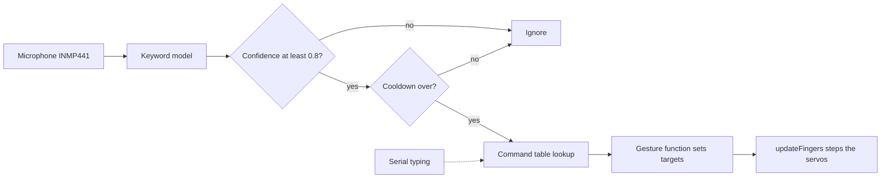

# Tutorial 8: The Voice-Controlled Hand

> **Time**: 60 min | **Difficulty**: Beginner
> **Prerequisites**: [Tutorial 4](../04-the-hand/lesson.md), [Tutorial 5](../05-typed-commands/lesson.md), [Tutorial 6](../06-microphone/lesson.md), [Tutorial 7](../07-keyword-spotting/lesson.md)

## What You'll Learn

- How the listening, deciding and acting parts fit into one sketch.
- How a confidence gate and a cooldown stop false and repeated moves.
- How to test the finished hand and tune it with numbers.

## Why This Matters

:::hook {kind="story"}
You have a hand that obeys typing and a model that hears three words. Each works alone. Today you join them with about thirty lines of glue, say "close", and watch the fingers curl. After that comes the part that separates a demo from a robot you trust: making it ignore the world around it.
:::

**Key idea: a voice-controlled hand is the pipeline listen, decide, act, and the decide step, a confidence gate plus a cooldown plus the command table, is what makes it reliable.**

Three points support it:
1. Every earlier lesson is one stage of the pipeline; joining them takes little new code.
2. The gate and the cooldown stop false and repeated actions.
3. Numbers from a simple test tell you what to tune.

## Walkthrough

### Step 1: The pipeline

:::note {kind="key"}
Listen, decide, act: the microphone and model produce a label with a confidence (listen), the gate, cooldown and command table choose whether to act (decide), and a gesture function sets the finger targets that the servos follow (act).
:::

:::analogy {concept="c23"}
title: A receptionist, a manager and a courier
boundary: People can ask questions back; each stage here only passes a number or a name forward.
---
The receptionist hears a visitor and says "I think they said close, about 90% sure" (listen). The manager decides: sure enough, and nothing happened recently, so yes (decide). The courier carries the order to the fingers (act).
:::

:::diagram
title: The finished hand
---

:::

One timing detail: the model's loop waits for each slice of audio, so it passes only a few times a second, while smooth movement wants a step every 15 ms. The simple fix is to call `updateFingers()` once on every pass of `loop()` and use a bigger step (STEP_DEG = 8) so the hand does not crawl. That is all this lesson needs.

:::example {concept="c23" level="realistic"}
title: Move the hand code into its own tab
---
In the Arduino IDE use the small arrow at the right of the tab bar and choose New Tab, name it `hand.ino`. Put the hand code from lesson 5 in it, with the setup and loop pieces turned into functions:

```cpp
// hand.ino
#include <ESP32Servo.h>

const int FINGERS = 5;
const int PINS[FINGERS]     = {13, 14, 25, 26, 27};
int OPEN_ANGLE[FINGERS]     = {30, 30, 30, 30, 30};      // your calibrated numbers
int CLOSED_ANGLE[FINGERS]   = {150, 150, 150, 150, 150}; // your calibrated numbers

const int STEP_DEG = 8;                 // bigger steps: loop() runs only a few times a second
const unsigned long STEP_MS = 15;

Servo servos[FINGERS];
int targetAngle[FINGERS];
int currentAngle[FINGERS];
unsigned long lastStep = 0;

void setFinger(int i, bool open) { targetAngle[i] = open ? OPEN_ANGLE[i] : CLOSED_ANGLE[i]; }
void openHand()  { for (int i = 0; i < FINGERS; i++) setFinger(i, true); }
void closeHand() { for (int i = 0; i < FINGERS; i++) setFinger(i, false); }
void pointHand() { for (int i = 0; i < FINGERS; i++) setFinger(i, i == 1); }

void updateFingers() {
  if (millis() - lastStep < STEP_MS) return;
  lastStep = millis();
  for (int i = 0; i < FINGERS; i++) {
    if (currentAngle[i] < targetAngle[i]) currentAngle[i] = min(currentAngle[i] + STEP_DEG, targetAngle[i]);
    else if (currentAngle[i] > targetAngle[i]) currentAngle[i] = max(currentAngle[i] - STEP_DEG, targetAngle[i]);
    servos[i].write(currentAngle[i]);
  }
}

struct Command { const char *name; void (*run)(); };
const Command COMMANDS[] = { {"open", openHand}, {"close", closeHand}, {"point", pointHand} };
const int COMMAND_COUNT = sizeof(COMMANDS) / sizeof(COMMANDS[0]);

bool runCommand(const char *word) {
  for (int i = 0; i < COMMAND_COUNT; i++) {
    if (strcmp(word, COMMANDS[i].name) == 0) { COMMANDS[i].run(); return true; }
  }
  return false;   // noise, unknown or anything else: no row, no action
}

void handBegin() {
  for (int i = 0; i < FINGERS; i++) {
    servos[i].attach(PINS[i], 500, 2400);
    currentAngle[i] = OPEN_ANGLE[i];
    targetAngle[i]  = OPEN_ANGLE[i];
    servos[i].write(currentAngle[i]);
  }
}

void checkTyped() {                    // typed words still work as a backup
  if (Serial.available() == 0) return;
  String w = Serial.readStringUntil('\n');
  w.trim(); w.toLowerCase();
  if (w.length() > 0) Serial.println(runCommand(w.c_str()) ? "typed ok" : "typed unknown");
}
```
Same code as lesson 5, in the shape the model sketch can call.
:::

:::checkpoint {concept="c23"}
question: Why does hand.ino not need a command for noise or unknown?
expected: runCommand only runs words that have a table row. A label with no row returns false and nothing happens.
---
:::

### Step 2: Cooldown and the gate

:::note {kind="key"}
Cooldown (debouncing): after an action fires, ignoring further triggers for a short time, so one event that lasts several readings counts once.
:::

:::analogy {concept="c24"}
title: A lift button that lights up
boundary: A lift button just stays lit; our cooldown ends by itself after a fixed time.
---
You press the button once and it lights. Pressing it ten more times in the next second does nothing extra; it has already heard you.
:::

The model reports each word over several overlapping slices. One spoken "close" may be seen as close, close, close. The cooldown makes that one action. It works together with the confidence gate from lesson 7.

:::example {concept="c24" level="realistic"}
title: The glue between model and hand
---
```cpp
// voice_glue.ino
// A second tab; the main sketch calls onHeard().
const float CONFIDENCE_GATE = 0.80;     // how sure the model must be
const unsigned long COOLDOWN_MS = 1200; // quiet time after an action
unsigned long lastAction = 0;

void onHeard(const char *label, float score) {
  if (score < CONFIDENCE_GATE) return;                  // not sure enough
  if (millis() - lastAction < COOLDOWN_MS) return;      // too soon after the last move
  if (runCommand(label)) {                              // table lookup + act
    lastAction = millis();                              // start the cooldown only on a real command
    Serial.printf("voice: %s (%.2f)\n", label, score);
  }
}
```
:::

Now connect it to the Edge Impulse example. Start from **esp32_microphone_continuous** (lesson 7) with the pins set to 32, 33 and 34. Make three small changes:

:::example {concept="c23" level="challenging"}
title: Three edits to the Edge Impulse sketch
---
```cpp
// esp32_microphone_continuous.ino
// 1. in setup(), after the serial and classifier set-up lines:
handBegin();                          // attach the servos and start open

// 2. in loop(), at the very top:
checkTyped();                         // typed words still work
updateFingers();                      // one small finger step on every pass

// 3. in loop(), after run_classifier_continuous(...) has filled `result`:
int best = 0;
for (size_t ix = 1; ix < EI_CLASSIFIER_LABEL_COUNT; ix++) {
  if (result.classification[ix].value > result.classification[best].value) best = ix;
}
onHeard(result.classification[best].label, result.classification[best].value);
```
The exact names near these lines depend on the version of the library Edge Impulse exported for you; keep its own calls and add only these three groups of lines.
:::

:::widget {id="cooldown" kind="simulation" height="320" title="Cooldown on a spoken word" concept="c24" alt="A row of model readings for one spoken close, each with a confidence. Sliders set the confidence gate and the cooldown; the page shows how many times the hand acts."}
```css
.strip { display: flex; gap: 4px; align-items: flex-end; height: 90px; border-bottom: 1px solid var(--line); }
.strip span { flex: 1; background: var(--dim); border-radius: 2px 2px 0 0; }
.strip span.act { background: var(--accent); }
label { display: flex; justify-content: space-between; color: var(--dim); margin-top: 8px; }
input[type=range] { width: 100%; accent-color: var(--accent); }
.out { margin-top: 8px; color: var(--text); }
```
```html
<div class="strip" id="strip" aria-hidden="true"></div>
<label for="g">Confidence gate <b id="gv">0.80</b></label>
<input id="g" type="range" min="0.3" max="0.99" step="0.01" value="0.8">
<label for="c">Cooldown <b id="cv">1200 ms</b></label>
<input id="c" type="range" min="0" max="3000" step="100" value="1200">
<p class="out" id="out" role="status"></p>
```
```js
const SCORES = [0.41,0.72,0.88,0.93,0.95,0.91,0.86,0.62,0.35,0.9,0.94,0.5];
const SLICE_MS = 250;
function draw() {
  const g = document.getElementById('g').valueAsNumber;
  const c = document.getElementById('c').valueAsNumber;
  if (!Number.isFinite(g) || !Number.isFinite(c)) return;
  document.getElementById('gv').textContent = g.toFixed(2);
  document.getElementById('cv').textContent = c + ' ms';
  const strip = document.getElementById('strip');
  strip.replaceChildren();
  let last = -1e9, acts = 0;
  SCORES.forEach(function (s, i) {
    const t = i * SLICE_MS;
    const b = document.createElement('span');
    b.style.height = (s * 100) + '%';
    if (s >= g && t - last >= c) { b.className = 'act'; last = t; acts++; }
    strip.appendChild(b);
  });
  document.getElementById('out').textContent =
    'The hand acts ' + acts + ' time(s) for one spoken word (readings come every 250 ms).';
}
function setup() {
  document.getElementById('g').addEventListener('input', draw);
  document.getElementById('c').addEventListener('input', draw);
  draw();
}
```
```js-run
setup();
```
:::

**Try it now:** set the cooldown to 0 and count the actions, then raise it until the hand acts once.

:::checkpoint {concept="c24"}
question: What happens if COOLDOWN_MS is 5000 and you say "open" then "close" two seconds later?
expected: The close is ignored because the 5 second cooldown has not ended, so a long cooldown makes the hand feel unresponsive.
---
:::

### Step 3: Test and tune

:::note {kind="key"}
Tuning: changing one setting at a time, measuring hits and false alarms before and after, and keeping the change only if the numbers improve.
:::

:::analogy {concept="c25"}
title: Tuning a guitar one string at a time
boundary: A guitar has a perfect target note; the hand has a trade-off, so there is no single right setting, only a good one for your room.
---
If you turn all pegs at once, you cannot tell which helped. Turn one, listen, then decide.
:::

A simple scorecard:

| Test | How | Record |
|---|---|---|
| Hits | Say each word 10 times, normal voice, at about 50 cm | Correct moves out of 10, per word |
| Distance | Repeat at 1.5 m | Correct moves out of 10 |
| False alarms | Play TV or talk with friends for 5 minutes, without saying the words | Number of moves |
| Servo noise | Command all poses in a row | Any resets or self-triggers? |

:::chart {type="bar" title="Example scorecard at three confidence gates (illustrative)" x="Confidence gate" y="Count out of 30 spoken commands, and false moves in 5 min" alt="At a gate of 0.6, 29 commands work but 9 false moves happen. At 0.8, 27 work and 2 false moves. At 0.95, 18 work and 0 false moves." source="illustrative"}
Gate 0.6 hits, 29
Gate 0.8 hits, 27
Gate 0.95 hits, 18
Gate 0.6 false moves, 9
Gate 0.8 false moves, 2
Gate 0.95 false moves, 0
:::

Which setting fixes which problem:

| Symptom | First thing to change |
|---|---|
| Twitches on chatter or TV | Raise CONFIDENCE_GATE; add noise and unknown clips |
| Misses real commands | Lower the gate a little; add clips of that word; move the mic closer |
| Triggers twice | Increase COOLDOWN_MS |
| Feels laggy | Decrease COOLDOWN_MS; raise STEP_DEG |
| Board resets when closing | Check supply (5 V, 3 A or more), capacitor, common ground; lower STEP_DEG |
| Hand triggers itself when servos run | Move the mic away from servo wires; add servo-noise clips to noise |

:::example {concept="c25" level="minimal"}
title: One change, two numbers
---
```text
# tuning-log.txt
Baseline : gate 0.80 -> hits 27/30, false moves 2 in 5 min
Change   : gate 0.85 -> hits 25/30, false moves 0 in 5 min
Decision : keep 0.85 (lost 2 hits, removed all false moves)
```
Write each change this way in a notebook. It tells you what helped.
:::

:::checkpoint {concept="c25"}
question: You changed the gate and added 20 clips of noise in the same step. Why is that a poor way to tune?
expected: You cannot tell which change caused the improvement or the loss. Change one thing at a time and record the numbers.
---
:::

:::note {kind="warning"}
Safety: the hand can pinch. Keep fingers clear when the supply is on, switch the 5 V supply off when adjusting lines, and add a way to cut power quickly, such as a switch on the supply lead.
:::

:::note {kind="tip"}
Optional bonus, after your hand obeys your voice: move the finger stepping into a FreeRTOS **task**, a second worker the chip runs alongside `loop()`, so the fingers step every 5 ms even while the model waits for audio. In hand.ino add `void handTask(void *unused) { for (;;) { updateFingers(); vTaskDelay(pdMS_TO_TICKS(5)); } }`, start it at the end of `handBegin()` with `xTaskCreate(handTask, "hand", 4096, NULL, 1, NULL);`, remove the `updateFingers()` call from `loop()`, mark `targetAngle` as `volatile int`, and set STEP_DEG back to 2. This is a shortcut, safe only because each target is one small int written in a single step; `volatile` just forces a fresh read and is not a general safety tool (atomics and mutexes are the next thing to learn).
:::

## Common Mistakes

:::mistake {concept="c23" title="Calling delay() in the listening loop"}
::wrong
```cpp
// esp32_microphone_continuous.ino
closeHand();
delay(2000);   // wait for the hand
```
::right
```cpp
// esp32_microphone_continuous.ino
closeHand();   // sets the targets; updateFingers() does the moving a step at a time
```
::why
delay() stops the model from reading audio, so it would miss the next word. Targets plus small steps keep the board listening.
:::

:::mistake {concept="c24" title="Starting the cooldown on every reading"}
::wrong
```cpp
// voice_glue.ino
lastAction = millis();            // set before checking if it is a command
if (runCommand(label)) { /* ... */ }
```
::right
```cpp
// voice_glue.ino
if (runCommand(label)) { lastAction = millis(); }
```
::why
If every noise reading restarts the cooldown, a real command spoken right after a noise would be ignored.
:::

:::mistake {concept="c25" title="Judging by feel after one try"}
::wrong
"It worked twice, so it's done."
::right
Ten trials per word and five minutes of background noise, with the numbers written down.
::why
A model that is right 70% of the time still looks fine in two tries.
:::

## Try It Yourself

:::challenge
title: Add a fourth word and a safety word
---
::task
Add the command "stop" that returns the hand to open and makes it ignore voice for 10 seconds (a "mute" mode), and add a fourth gesture word you trained at the end of lesson 7, such as "peace".
::hint
Make a bool or a timestamp `mutedUntil`; onHeard returns early while millis() is below it. A stop function sets it and calls openHand().
::solution
```cpp
// voice_glue.ino
// Changes: add {"stop", stopHand} to COMMANDS in hand.ino.
unsigned long mutedUntil = 0;

void stopHand() {
  openHand();
  mutedUntil = millis() + 10000;
}

void onHeard(const char *label, float score) {
  if (millis() < mutedUntil && strcmp(label, "stop") != 0) return;  // muted
  if (score < CONFIDENCE_GATE) return;
  if (millis() - lastAction < COOLDOWN_MS) return;
  if (runCommand(label)) { lastAction = millis(); }
}
```
Declare mutedUntil before stopHand; the stop word itself is still heard even while muted.
:::

1. Assemble the full sketch and say each word ten times; record your scorecard.
2. Adjust one setting from the table and measure again.
3. Show the hand to someone else and have them command it; note which words fail for them.

:::quiz {ref="q2"}
:::

:::quiz {ref="q6"}
:::

## Key Takeaways

:::takeaways
- The voice hand is a pipeline: listen (mic and model), decide (gate, cooldown, command table), act (gesture sets targets, updateFingers steps the servos).
- A table row exists only for real commands, so noise and unknown do nothing.
- The cooldown turns several readings of one word into one action; start it only on real commands.
- Tune with a scorecard: one change at a time, hits and false alarms, written down.
:::

You started with a single blinking LED and finished with a hand that obeys your voice. The ideas come back in bigger robots: power with a shared ground, calibrated motion, and a pipeline that senses, decides and acts.

## What's Next

You have reached the course goal. Good next steps: more words and more training voices, replacing the tendon hand's lines with sturdier ones, adding a button or a touch sensor as a second input, or moving to an ESP32-S3 board and Espressif's own on-device speech tools. The Edge Impulse docs and the Arduino-ESP32 docs are the best places to continue.

:::bridge {to="05-typed-commands"}
We met the command table in [lesson 5: Typed Commands](../05-typed-commands/lesson.md): a list pairing each word with a function, and a lookup that runs it. In this lesson we went further: the word no longer comes from the keyboard but from the model's label, and the same table decides. Words with no row, like noise and unknown, are ignored for free.
:::

:::bridge {to="06-microphone"}
We met the cooldown in [lesson 6: The Microphone](../06-microphone/lesson.md): after a clap, ignore new ones for a short time. In this lesson we went further: the same idea guards the model, along with the confidence gate from [lesson 7: Keyword Spotting](../07-keyword-spotting/lesson.md).
:::

:::bridge {to="07-keyword-spotting"}
The finished hand is the model from lesson 7 with a body. Every improvement you make starts with better examples and a measured gate.
:::

:::homework {kind="build"}
Finish and tidy the hand: cable-tie the wires, label the supply, and put the microphone on a short stand away from the servos. Then record a 30-second video of the hand obeying your voice and write down your final gate, cooldown and scorecard. Ideas for what to build next: add a second microphone position, teach the hand a counting mode ("one" to "five"), or add an ESP32-S3 board for faster recognition.
:::

## Further Reading

:::docs
title: Edge Impulse documentation
url: https://docs.edgeimpulse.com/
---
For retraining, adding words and understanding model performance; this lesson showed the glue and the tuning loop.
:::

:::docs
title: ESP32 FreeRTOS tasks (Arduino-ESP32)
url: https://docs.espressif.com/projects/arduino-esp32/en/latest/tutorials/cores_config.html
---
Explains the cores and tasks used in the optional bonus box; the main path needs no tasks.
:::
